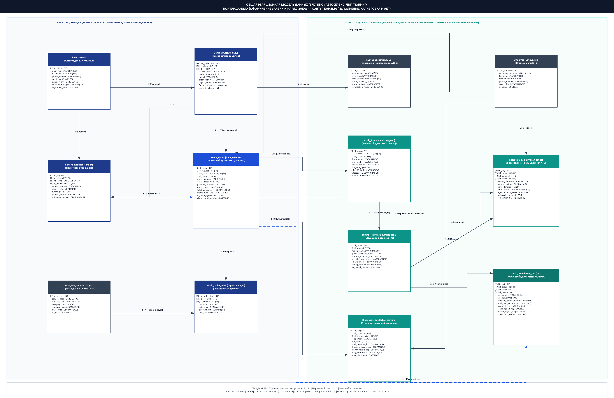

# Общая реляционная модель данных (ERD) КИС «Автосервис: Чип-тюнинг»

**Дисциплина:** Корпоративные информационные системы (КИС)  
**Университет:** ФГБОУ ВО «Уфимский университет науки и технологий» (УУНиТ), каф. АСУ  
**Преподаватель:** ст. преп. Демченко М.С.  
**Разработчики:** студенты гр. ЭАС-514С Гайнанов Данил и [Партнер] Карим  
**Год:** 2026  

---

## 1. Концепция и структура общей модели данных

В соответствии с требованиями лабораторного практикума по КИС разработана **единая сквозная реляционная модель данных (ERD)**, объединяющая информационные сущности обоих участников проектной группы:
1. **Контур студента 1 (Данил) — «Оформление заявки клиента и наряд-заказ»:**
   - Учет физических и юридических лиц (`Client`);
   - Регистрация транспортных средств (`Vehicle`);
   - Первичные обращения и пожелания клиента (`Service_Request`);
   - Прейскурант и нормо-часы работ (`Price_List_Service`);
   - **Ключевой документ Данила:** утвержденный наряд-заказ (`Work_Order`) и его спецификация (`Work_Order_Item`).
2. **Контур студента 2 (Карим) — «Исполнение наряд-заказа, чип-тюнинг и акт»:**
   - Справочник аппаратных спецификаций ЭБУ и процессоров (`ECU_Specification`);
   - Протоколы входной и выходной компьютерной диагностики (`Diagnostic_Card`);
   - Защищенный архив заводских прошивок со сбором хэшей SHA-256 (`Stock_Firmware`);
   - Каталог модифицированных калибровок Stage 1 / Stage 2 / Евро-2 с контрольными суммами CRC32 (`Tuning_Firmware`);
   - **Журнал выполнения + ТЕХНИЧЕСКИЙ КОММЕНТАРИЙ мастера** (`Execution_Log`);
   - **Ключевой документ Карима:** финальный акт сдачи-приемки и гарантийный сертификат (`Work_Completion_Act`).
3. **Общесистемный контур КИС:**
   - Штатное расписание, должности и уровни доступа сотрудников (`Employee`).

Модель приведена к **третьей нормальной форме (3NF)**: отсутствуют дублирующиеся группы данных (1NF), все неключевые атрибуты функционально зависят от полного составного первичного ключа (2NF), отсутствуют транзитивные зависимости между неключевыми полями (3NF).

---

## 2. Графическая схема ERD в нотации IDEF1X / Crow's Foot (Visio)

- **Файл Microsoft Visio (.vsdx):** [ER_модель_КИС_ЧипТюнинг.vsdx](file:///c:/Users/danch/OneDrive/Рабочий%20стол/stage5/КИС/ER_модель_КИС_ЧипТюнинг.vsdx)
- **Изображение высокого разрешения (.png):** [ER_модель_КИС_ЧипТюнинг.png](file:///c:/Users/danch/OneDrive/Рабочий%20стол/stage5/КИС/ER_модель_КИС_ЧипТюнинг.png)



---

## 3. Детальная спецификация таблиц базы данных

### Зона 1: Контур Данила (Клиенты, Автомобили, Заявки, Наряд-заказ)

#### 1. Таблица `Client` (Клиенты автосервиса)
Хранит персональные и контактные данные физических лиц либо реквизиты юридических лиц.
| Поле | Тип данных | Ограничения | Назначение |
| :--- | :--- | :--- | :--- |
| `id_client` | INT | PRIMARY KEY, AUTO_INCREMENT | Уникальный суррогатный идентификатор клиента |
| `client_type` | VARCHAR(20) | NOT NULL, CHECK in ('Физлицо', 'Юрлицо') | Тип контрагента |
| `full_name` | VARCHAR(150) | NOT NULL | ФИО автовладельца / Наименование организации |
| `phone_number` | VARCHAR(20) | NOT NULL, UNIQUE | Основной номер телефона для SMS/Telegram |
| `email` | VARCHAR(100) | NULL | Адрес электронной почты для отправки отчетов |
| `passport_inn` | VARCHAR(50) | NULL | Серия/номер паспорта либо ИНН компании |
| `discount_rate_pct`| DECIMAL(4,2)| DEFAULT 0.00 | Размер индивидуальной скидки (%) |
| `registered_date` | DATETIME | NOT NULL, DEFAULT NOW() | Дата регистрации в базе КИС |

#### 2. Таблица `Vehicle` (Транспортные средства)
Идентифицирует автомобили клиентов по уникальному международному номеру VIN.
| Поле | Тип данных | Ограничения | Назначение |
| :--- | :--- | :--- | :--- |
| `vin_code` | VARCHAR(17) | PRIMARY KEY | 17-значный уникальный идентификатор авто (VIN) |
| `id_client` | INT | NOT NULL, FOREIGN KEY $\rightarrow$ `Client` | Текущий владелец автомобиля |
| `id_ecu` | INT | NOT NULL, FOREIGN KEY $\rightarrow$ `ECU_Specification` | Установленный контроллер ЭСУД |
| `license_plate` | VARCHAR(15) | NOT NULL | Государственный регистрационный знак |
| `brand` | VARCHAR(50) | NOT NULL | Марка автомобиля (BMW, Audi, Mercedes, VAG) |
| `model` | VARCHAR(50) | NOT NULL | Модель автомобиля (330i G20, Golf R, Octavia A8) |
| `production_year` | SMALLINT | NOT NULL | Год выпуска автомобиля |
| `engine_code` | VARCHAR(30) | NOT NULL | Буквенный код двигателя (B48B20O1, EA888 Gen3) |
| `factory_power_hp`| SMALLINT | NOT NULL | Заводская мощность двигателя (л.с.) |
| `current_mileage` | INT | NOT NULL | Текущий зафиксированный пробег (км) |

#### 3. Таблица `Service_Request` (Заявки клиентов)
Фиксирует первичное обращение клиента и его пожелания к настройке ТС.
| Поле | Тип данных | Ограничения | Назначение |
| :--- | :--- | :--- | :--- |
| `id_request` | INT | PRIMARY KEY, AUTO_INCREMENT | Уникальный номер заявки в КИС |
| `id_client` | INT | NOT NULL, FOREIGN KEY $\rightarrow$ `Client` | Клиент-заказчик |
| `vin_code` | VARCHAR(17) | NOT NULL, FOREIGN KEY $\rightarrow$ `Vehicle` | Обслуживаемый автомобиль |
| `id_employee` | INT | NOT NULL, FOREIGN KEY $\rightarrow$ `Employee` | Мастер-приемщик, зарегистрировавший заявку |
| `request_number` | VARCHAR(30) | NOT NULL, UNIQUE | Номер заявки (например, З-2026-0814) |
| `request_date` | DATETIME | NOT NULL, DEFAULT NOW() | Временная метка создания заявки |
| `tuning_goals` | TEXT | NOT NULL | Пожелания клиента (Stage 1, Euro-2, Pops) |
| `request_status` | VARCHAR(30) | NOT NULL | `Новая`, `Согласована`, `Отклонена`, `В_наряде` |
| `estimated_budget`| DECIMAL(10,2)| NULL | Предварительно озвученный клиентом бюджет |

#### 4. Таблица `Price_List_Service` (Справочник услуг)
Нормативно-справочная информация о стоимости услуг сервиса и нормативах трудоемкости.
| Поле | Тип данных | Ограничения | Назначение |
| :--- | :--- | :--- | :--- |
| `id_service` | INT | PRIMARY KEY, AUTO_INCREMENT | Код услуги в справочнике КИС |
| `service_code` | VARCHAR(30) | NOT NULL, UNIQUE | Артикул (CHIP-ST1, DPF-OFF, DIAG-IN) |
| `service_name` | VARCHAR(150) | NOT NULL | Наименование технологической услуги |
| `category` | VARCHAR(50) | NOT NULL | `Калибровка`, `Диагностика`, `Экология` |
| `standard_hours` | DECIMAL(4,2) | NOT NULL | Норма времени выполнения (нормо-часы) |
| `base_price` | DECIMAL(10,2) | NOT NULL | Базовая стоимость работы по прайс-листу (руб.) |
| `is_active` | BOOLEAN | DEFAULT TRUE | Доступность для заказа в текущем периоде |

#### 5. Таблица `Work_Order` (Наряд-заказ) — КЛЮЧЕВОЙ ДОКУМЕНТ ДАНИЛА
Основной управляющий документ сервисного центра, санкционирующий прием ТС и проведение работ в цеху.
| Поле | Тип данных | Ограничения | Назначение |
| :--- | :--- | :--- | :--- |
| `id_order` | INT | PRIMARY KEY, AUTO_INCREMENT | Уникальный внутренний идентификатор наряда |
| `id_request` | INT | NOT NULL, FOREIGN KEY $\rightarrow$ `Service_Request` | Заявка-основание |
| `vin_code` | VARCHAR(17) | NOT NULL, FOREIGN KEY $\rightarrow$ `Vehicle` | Принятый в сервис автомобиль |
| `id_master` | INT | NOT NULL, FOREIGN KEY $\rightarrow$ `Employee` | Ответственный мастер-приемщик (консультант) |
| `order_number` | VARCHAR(30) | NOT NULL, UNIQUE | Номер документа (например, НЗ-2026-0412) |
| `order_date` | DATETIME | NOT NULL, DEFAULT NOW() | Дата и время оформления и приемки авто |
| `planned_deadline`| DATETIME | NOT NULL | Нормативный срок готовности автомобиля |
| `order_status` | VARCHAR(30) | NOT NULL | `Оформлен`, `В_цехе`, `На_диагностике`, `Прошивается`, `Тест_драйв`, `Готов`, `Закрыт` |
| `total_agreed_cost`| DECIMAL(10,2)| NOT NULL | Итоговая согласованная с клиентом смета |
| `intake_fuel_level`| VARCHAR(20) | NOT NULL | Уровень топлива при приемке авто |
| `is_client_agreed` | BOOLEAN | NOT NULL, DEFAULT FALSE | Факт подписания согласия клиентом |
| `client_signature_date`| DATETIME | NULL | Время подписания документа заказчиком |

#### 6. Таблица `Work_Order_Item` (Позиции наряд-заказа)
Детализация утвержденных работ и услуг в рамках наряд-заказа.
| Поле | Тип данных | Ограничения | Назначение |
| :--- | :--- | :--- | :--- |
| `id_order_item` | INT | PRIMARY KEY, AUTO_INCREMENT | Уникальный номер строки спецификации |
| `id_order` | INT | NOT NULL, FOREIGN KEY $\rightarrow$ `Work_Order` | Привязка к наряд-заказу |
| `id_service` | INT | NOT NULL, FOREIGN KEY $\rightarrow$ `Price_List_Service` | Оказываемая услуга из прейскуранта |
| `quantity` | SMALLINT | NOT NULL, DEFAULT 1 | Количество нормо-услуг |
| `unit_price` | DECIMAL(10,2) | NOT NULL | Примененная цена за единицу (с учетом скидок) |
| `discount_pct` | DECIMAL(4,2) | DEFAULT 0.00 | Предоставленная скидка по позиции (%) |
| `item_total` | DECIMAL(10,2) | NOT NULL | Итоговая сумма по строке наряд-заказа |

---

### Зона 2: Контур Карима (Диагностика, Прошивки, Выполнение+коммент, Акт)

#### 7. Таблица `ECU_Specification` (Справочник ЭБУ)
Паспортные характеристики электронных блоков управления, микроконтроллеров и протоколов связи.
| Поле | Тип данных | Ограничения | Назначение |
| :--- | :--- | :--- | :--- |
| `id_ecu` | INT | PRIMARY KEY, AUTO_INCREMENT | Уникальный идентификатор блока в базе |
| `ecu_vendor` | VARCHAR(50) | NOT NULL | Производитель блока (Bosch, Continental, Denso) |
| `ecu_model` | VARCHAR(50) | NOT NULL | Семейство ЭБУ (MG1CS001, Simos 18.1, MED17.5) |
| `mcu_processor`| VARCHAR(50) | NOT NULL | Процессор (Infineon TriCore TC298, NXP MPC5777) |
| `flash_capacity_bytes` | INT | NOT NULL | Объем flash-памяти в байтах (например, 4194304) |
| `protocol_type` | VARCHAR(50) | NOT NULL | Протокол обмена (UDS on CAN, K-Line, DoIP) |
| `connection_mode`| VARCHAR(30) | NOT NULL | Метод программирования (`OBD-II`, `Bench`, `Boot`) |

#### 8. Таблица `Stock_Firmware` (Архив оригинальных заводских прошивок)
Обеспечивает WORM-хранение оригинальных дампов для гарантии возможности возврата на заводской софт.
| Поле | Тип данных | Ограничения | Назначение |
| :--- | :--- | :--- | :--- |
| `id_stock` | INT | PRIMARY KEY, AUTO_INCREMENT | Уникальный номер архивной копии стока |
| `vin_code` | VARCHAR(17) | NOT NULL, FOREIGN KEY $\rightarrow$ `Vehicle` | Идентификатор автомобиля-донора |
| `id_order` | INT | NOT NULL, FOREIGN KEY $\rightarrow$ `Work_Order` | Наряд-заказ, в рамках которого вычитан сток |
| `hw_number` | VARCHAR(50) | NOT NULL | Аппаратный номер электронного блока (HW) |
| `sw_number` | VARCHAR(50) | NOT NULL | Заводская версия программного обеспечения (SW) |
| `calibration_id`| VARCHAR(50) | NOT NULL | Калибровочный код прошивки |
| `file_size_bytes`| INT | NOT NULL | Размер считанного бинарного файла (.bin) |
| `sha256_hash` | VARCHAR(64) | NOT NULL, UNIQUE | 64-символьный хэш SHA-256 для контроля целостности |
| `storage_path` | VARCHAR(255) | NOT NULL | Защищенный путь к файлу в хранилище КИС |
| `backup_timestamp`| DATETIME | NOT NULL, DEFAULT NOW() | Точное время завершения резервного копирования |

#### 9. Таблица `Tuning_Firmware` (Каталог калибровок и модифицированных прошивок)
Содержит проверенные калибровочные файлы с фиксацией характеристик прироста.
| Поле | Тип данных | Ограничения | Назначение |
| :--- | :--- | :--- | :--- |
| `id_tuned` | INT | PRIMARY KEY, AUTO_INCREMENT | Уникальный номер калибровочного решения |
| `id_stock` | INT | NOT NULL, FOREIGN KEY $\rightarrow$ `Stock_Firmware` | Исходная заводская прошивка, взятая за основу |
| `tuning_name` | VARCHAR(100) | NOT NULL | Имя прошивки (например, `STAGE1_95RON_V2`) |
| `power_increase_hp`| SMALLINT | NOT NULL | Расчетная прибавка мощности (+35 л.с.) |
| `torque_increase_nm`| SMALLINT | NOT NULL | Расчетная прибавка крутящего момента (+65 Нм) |
| `disabled_eco_masks`| VARCHAR(150)| NULL | Отключенные маски ошибок (`DPF_OFF`, `EGR_OFF`) |
| `checksum_crc32`| VARCHAR(10) | NOT NULL | Контрольная сумма модифицированных секторов |
| `tuning_software`| VARCHAR(50) | NOT NULL | Редактор калибровок (`WinOLS 4.7`, `Titanium`) |
| `is_tested_verified`| BOOLEAN | DEFAULT TRUE | Флаг прохождения проверки на динамостенде |

#### 10. Таблица `Diagnostic_Card` (Диагностические карты ЭСУД)
Фиксирует инструментальные замеры входного и выходного контроля двигателя.
| Поле | Тип данных | Ограничения | Назначение |
| :--- | :--- | :--- | :--- |
| `id_diag` | INT | PRIMARY KEY, AUTO_INCREMENT | Номер диагностического протокола |
| `id_order` | INT | NOT NULL, FOREIGN KEY $\rightarrow$ `Work_Order` | Привязка к наряд-заказу |
| `id_diagnostician`| INT | NOT NULL, FOREIGN KEY $\rightarrow$ `Employee` | Ответственный инженер-диагност |
| `diag_stage` | VARCHAR(20) | NOT NULL, CHECK in ('Входной', 'Выходной') | Этап проверки автомобиля |
| `dtc_codes_list`| TEXT | NULL | Список зафиксированных кодов ошибок (DTC) |
| `fuel_pressure_bar`| DECIMAL(6,2)| NOT NULL | Давление в топливной рампе ТНВД (бар) |
| `boost_pressure_bar`| DECIMAL(4,2)| NOT NULL | Фактическое давление наддува турбокомпрессора |
| `knock_retard_deg`| DECIMAL(4,2)| NOT NULL | Откаты углов опережения зажигания по детонации |
| `diag_conclusion`| VARCHAR(30) | NOT NULL | `Допущен`, `Дефектовка_отказ`, `Норма`, `Доработка` |
| `diag_timestamp` | DATETIME | NOT NULL, DEFAULT NOW() | Время проведения контрольного замера |

#### 11. Таблица `Execution_Log` (Журнал работ) — ВЫПОЛНЕНИЕ + КОММЕНТАРИЙ МАСТЕРА
Фиксирует технические параметры прошивки и обязательный комментарий калибровщика по требованию задания Карима.
| Поле | Тип данных | Ограничения | Назначение |
| :--- | :--- | :--- | :--- |
| `id_log` | INT | PRIMARY KEY, AUTO_INCREMENT | Уникальный номер записи в журнале прошивки |
| `id_order` | INT | NOT NULL, FOREIGN KEY $\rightarrow$ `Work_Order` | Обслуживаемый наряд-заказ |
| `id_tuned` | INT | NOT NULL, FOREIGN KEY $\rightarrow$ `Tuning_Firmware` | Записанная калибровка |
| `id_tuner` | INT | NOT NULL, FOREIGN KEY $\rightarrow$ `Employee` | Калибровщик (специалист по чип-тюнингу) |
| `flasher_hardware`| VARCHAR(50)| NOT NULL | Оборудование (KESS v3, AutoTuner, PCMFlash) |
| `battery_voltage`| DECIMAL(4,2)| NOT NULL, CHECK (>= 13.8) | Напряжение АКБ во время прошивки (14.1 В) |
| `write_duration_sec`| INT | NOT NULL | Время записи Flash-памяти в секундах |
| `write_result_status`| VARCHAR(20)| NOT NULL | `Success_OK`, `Recovery_Mode_Bench` |
| `is_adaptations_reset`| BOOLEAN | NOT NULL, DEFAULT TRUE | Факт сброса сервисных адаптаций ЭБУ |
| **`technical_comment`** | **TEXT** | **NOT NULL** | **ТЕХНИЧЕСКИЙ КОММЕНТАРИЙ МАСТЕРА: октановое число АИ-100, масло, прибавка л.с.** |
| `completion_time`| DATETIME | NOT NULL, DEFAULT NOW() | Временная метка завершения операции |

#### 12. Таблица `Work_Completion_Act` (Акт выполненных работ) — КЛЮЧЕВОЙ ДОКУМЕНТ КАРИМА
Официальный юридический документ о завершении работ, передаче ТС владельцу и предоставлении гарантии.
| Поле | Тип данных | Ограничения | Назначение |
| :--- | :--- | :--- | :--- |
| `id_act` | INT | PRIMARY KEY, AUTO_INCREMENT | Внутренний идентификатор акта |
| `id_order` | INT | NOT NULL, UNIQUE, FOREIGN KEY $\rightarrow$ `Work_Order` | Закрываемый наряд-заказ (связь 1:1) |
| `id_tuned` | INT | NOT NULL, FOREIGN KEY $\rightarrow$ `Tuning_Firmware` | Установленная прошивка |
| `id_master` | INT | NOT NULL, FOREIGN KEY $\rightarrow$ `Employee` | Мастер-приемщик, выдавший автомобиль |
| `act_number` | VARCHAR(30) | NOT NULL, UNIQUE | Номер документа (например, АКТ-2026-0391) |
| `act_date` | DATETIME | NOT NULL, DEFAULT NOW() | Дата и время подписания акта |
| `warranty_period_months`| SMALLINT | NOT NULL, DEFAULT 24 | Срок гарантии на программное обеспечение |
| `total_paid_amount`| DECIMAL(10,2)| NOT NULL | Финальная оплаченная клиентом сумма (руб.) |
| `payment_type` | VARCHAR(30) | NOT NULL | `Банковская_карта`, `Наличные`, `Безнал` |
| `client_signed_flag`| BOOLEAN | NOT NULL, DEFAULT FALSE | Отметка о подписи акта клиентом |
| `master_signed_flag`| BOOLEAN | NOT NULL, DEFAULT FALSE | Отметка о подписи мастером |
| `satisfaction_rating`| SMALLINT | NULL, CHECK (1..5) | Оценка качества услуги клиентом (NPS) |

---

### Общий кадровый справочник

#### 13. Таблица `Employee` (Персонал автосервиса)
Хранит учетные записи и роли сотрудников в КИС.
| Поле | Тип данных | Ограничения | Назначение |
| :--- | :--- | :--- | :--- |
| `id_employee` | INT | PRIMARY KEY, AUTO_INCREMENT | Идентификатор сотрудника |
| `personnel_number`| VARCHAR(20)| NOT NULL, UNIQUE | Табельный номер сотрудника |
| `full_name` | VARCHAR(150) | NOT NULL | ФИО сотрудника |
| `role_title` | VARCHAR(50) | NOT NULL | `Мастер-приемщик`, `Диагност`, `Тюнер`, `Директор` |
| `phone_number` | VARCHAR(20) | NOT NULL | Корпоративный номер связи |
| `access_level` | VARCHAR(30) | NOT NULL | Уровень прав в КИС (`Master`, `Tech`, `Admin`) |
| `is_active` | BOOLEAN | DEFAULT TRUE | Статус работы в сервисе (активен/уволен) |

---

## 4. Схема связей между сущностями (Реляционные ограничения)

1. `Client` (1) $\longrightarrow$ (N) `Vehicle`: Один клиент может владеть несколькими автомобилями. Внешний ключ `Vehicle.id_client`.
2. `Client` (1) $\longrightarrow$ (N) `Service_Request`: Клиент может подавать несколько заявок за время обслуживания.
3. `Vehicle` (1) $\longrightarrow$ (N) `Service_Request`: К автомобилю привязываются заявки на обслуживание.
4. `Vehicle` (N) $\longrightarrow$ (1) `ECU_Specification`: Каждое ТС оснащено конкретным блоком управления из каталога.
5. `Service_Request` (1) $\longrightarrow$ (1) `Work_Order`: Каждая утвержденная заявка порождает ровно один наряд-заказ.
6. `Work_Order` (1) $\longrightarrow$ (N) `Work_Order_Item`: Наряд-заказ содержит перечень позиций работ.
7. `Price_List_Service` (1) $\longrightarrow$ (N) `Work_Order_Item`: Услуги из прейскуранта включаются в строки наряда.
8. `Work_Order` (1) $\longrightarrow$ (1) `Stock_Firmware`: В рамках наряда считывается и сохраняется дамп заводской прошивки.
9. `Stock_Firmware` (1) $\longrightarrow$ (N) `Tuning_Firmware`: На основе заводского стока создаются калибровки (Stage 1, Euro-2).
10. `Work_Order` (1) $\longrightarrow$ (N) `Diagnostic_Card`: К наряду прикрепляются карты входной и выходной диагностики.
11. `Work_Order` (1) $\longrightarrow$ (N) `Execution_Log`: Журнал фиксирует попытки записи ПО и комментарий мастера.
12. `Tuning_Firmware` (1) $\longrightarrow$ (N) `Execution_Log`: В журнал записывается ID прошивки, которая заливается во Flash.
13. `Work_Order` (1) $\longrightarrow$ (1) `Work_Completion_Act`: По завершении наряда формируется ровно один Акт выполненных работ.
14. `Tuning_Firmware` (1) $\longrightarrow$ (N) `Work_Completion_Act`: В Акт и гарантийный сертификат включаются данные финальной калибровки.
15. `Employee` (1) $\longrightarrow$ (N) `Work_Order`, `Diagnostic_Card`, `Execution_Log`: Привязка ответственных сотрудников по ролям.

---

## 5. SQL-скрипт создания базы данных (PostgreSQL / MySQL DDL)

```sql
-- =============================================================================
-- БАЗА ДАННЫХ КИС «АВТОСЕРВИС: ЧИП-ТЮНИНГ» (3NF)
-- ДАНИЛ (ЗАЯВКИ И НАРЯД-ЗАКАЗ) + КАРИМ (ИСПОЛНЕНИЕ, КАЛИБРОВКА И АКТ)
-- =============================================================================

CREATE TABLE Client (
    id_client SERIAL PRIMARY KEY,
    client_type VARCHAR(20) NOT NULL CHECK (client_type IN ('Физлицо', 'Юрлицо')),
    full_name VARCHAR(150) NOT NULL,
    phone_number VARCHAR(20) NOT NULL UNIQUE,
    email VARCHAR(100),
    passport_inn VARCHAR(50),
    discount_rate_pct DECIMAL(4,2) DEFAULT 0.00,
    registered_date TIMESTAMP NOT NULL DEFAULT CURRENT_TIMESTAMP
);

CREATE TABLE ECU_Specification (
    id_ecu SERIAL PRIMARY KEY,
    ecu_vendor VARCHAR(50) NOT NULL,
    ecu_model VARCHAR(50) NOT NULL,
    mcu_processor VARCHAR(50) NOT NULL,
    flash_capacity_bytes INT NOT NULL,
    protocol_type VARCHAR(50) NOT NULL,
    connection_mode VARCHAR(30) NOT NULL
);

CREATE TABLE Vehicle (
    vin_code VARCHAR(17) PRIMARY KEY,
    id_client INT NOT NULL REFERENCES Client(id_client) ON DELETE CASCADE,
    id_ecu INT NOT NULL REFERENCES ECU_Specification(id_ecu),
    license_plate VARCHAR(15) NOT NULL,
    brand VARCHAR(50) NOT NULL,
    model VARCHAR(50) NOT NULL,
    production_year SMALLINT NOT NULL,
    engine_code VARCHAR(30) NOT NULL,
    factory_power_hp SMALLINT NOT NULL,
    current_mileage INT NOT NULL
);

CREATE TABLE Employee (
    id_employee SERIAL PRIMARY KEY,
    personnel_number VARCHAR(20) NOT NULL UNIQUE,
    full_name VARCHAR(150) NOT NULL,
    role_title VARCHAR(50) NOT NULL,
    phone_number VARCHAR(20) NOT NULL,
    access_level VARCHAR(30) NOT NULL,
    is_active BOOLEAN DEFAULT TRUE
);

CREATE TABLE Service_Request (
    id_request SERIAL PRIMARY KEY,
    id_client INT NOT NULL REFERENCES Client(id_client),
    vin_code VARCHAR(17) NOT NULL REFERENCES Vehicle(vin_code),
    id_employee INT NOT NULL REFERENCES Employee(id_employee),
    request_number VARCHAR(30) NOT NULL UNIQUE,
    request_date TIMESTAMP NOT NULL DEFAULT CURRENT_TIMESTAMP,
    tuning_goals TEXT NOT NULL,
    request_status VARCHAR(30) NOT NULL,
    estimated_budget DECIMAL(10,2)
);

CREATE TABLE Price_List_Service (
    id_service SERIAL PRIMARY KEY,
    service_code VARCHAR(30) NOT NULL UNIQUE,
    service_name VARCHAR(150) NOT NULL,
    category VARCHAR(50) NOT NULL,
    standard_hours DECIMAL(4,2) NOT NULL,
    base_price DECIMAL(10,2) NOT NULL,
    is_active BOOLEAN DEFAULT TRUE
);

-- КЛЮЧЕВОЙ ДОКУМЕНТ ДАНИЛА:
CREATE TABLE Work_Order (
    id_order SERIAL PRIMARY KEY,
    id_request INT NOT NULL UNIQUE REFERENCES Service_Request(id_request),
    vin_code VARCHAR(17) NOT NULL REFERENCES Vehicle(vin_code),
    id_master INT NOT NULL REFERENCES Employee(id_employee),
    order_number VARCHAR(30) NOT NULL UNIQUE,
    order_date TIMESTAMP NOT NULL DEFAULT CURRENT_TIMESTAMP,
    planned_deadline TIMESTAMP NOT NULL,
    order_status VARCHAR(30) NOT NULL,
    total_agreed_cost DECIMAL(10,2) NOT NULL,
    intake_fuel_level VARCHAR(20) NOT NULL,
    is_client_agreed BOOLEAN NOT NULL DEFAULT FALSE,
    client_signature_date TIMESTAMP
);

CREATE TABLE Work_Order_Item (
    id_order_item SERIAL PRIMARY KEY,
    id_order INT NOT NULL REFERENCES Work_Order(id_order) ON DELETE CASCADE,
    id_service INT NOT NULL REFERENCES Price_List_Service(id_service),
    quantity SMALLINT NOT NULL DEFAULT 1,
    unit_price DECIMAL(10,2) NOT NULL,
    discount_pct DECIMAL(4,2) DEFAULT 0.00,
    item_total DECIMAL(10,2) NOT NULL
);

CREATE TABLE Stock_Firmware (
    id_stock SERIAL PRIMARY KEY,
    vin_code VARCHAR(17) NOT NULL REFERENCES Vehicle(vin_code),
    id_order INT NOT NULL REFERENCES Work_Order(id_order),
    hw_number VARCHAR(50) NOT NULL,
    sw_number VARCHAR(50) NOT NULL,
    calibration_id VARCHAR(50) NOT NULL,
    file_size_bytes INT NOT NULL,
    sha256_hash VARCHAR(64) NOT NULL UNIQUE,
    storage_path VARCHAR(255) NOT NULL,
    backup_timestamp TIMESTAMP NOT NULL DEFAULT CURRENT_TIMESTAMP
);

CREATE TABLE Tuning_Firmware (
    id_tuned SERIAL PRIMARY KEY,
    id_stock INT NOT NULL REFERENCES Stock_Firmware(id_stock),
    tuning_name VARCHAR(100) NOT NULL,
    power_increase_hp SMALLINT NOT NULL,
    torque_increase_nm SMALLINT NOT NULL,
    disabled_eco_masks VARCHAR(150),
    checksum_crc32 VARCHAR(10) NOT NULL,
    tuning_software VARCHAR(50) NOT NULL,
    is_tested_verified BOOLEAN DEFAULT TRUE
);

CREATE TABLE Diagnostic_Card (
    id_diag SERIAL PRIMARY KEY,
    id_order INT NOT NULL REFERENCES Work_Order(id_order),
    id_diagnostician INT NOT NULL REFERENCES Employee(id_employee),
    diag_stage VARCHAR(20) NOT NULL CHECK (diag_stage IN ('Входной', 'Выходной')),
    dtc_codes_list TEXT,
    fuel_pressure_bar DECIMAL(6,2) NOT NULL,
    boost_pressure_bar DECIMAL(4,2) NOT NULL,
    knock_retard_deg DECIMAL(4,2) NOT NULL,
    diag_conclusion VARCHAR(30) NOT NULL,
    diag_timestamp TIMESTAMP NOT NULL DEFAULT CURRENT_TIMESTAMP
);

-- ВЫПОЛНЕНИЕ + ТЕХНИЧЕСКИЙ КОММЕНТАРИЙ (КАРИМ):
CREATE TABLE Execution_Log (
    id_log SERIAL PRIMARY KEY,
    id_order INT NOT NULL REFERENCES Work_Order(id_order),
    id_tuned INT NOT NULL REFERENCES Tuning_Firmware(id_tuned),
    id_tuner INT NOT NULL REFERENCES Employee(id_employee),
    flasher_hardware VARCHAR(50) NOT NULL,
    battery_voltage DECIMAL(4,2) NOT NULL,
    write_duration_sec INT NOT NULL,
    write_result_status VARCHAR(20) NOT NULL,
    is_adaptations_reset BOOLEAN NOT NULL DEFAULT TRUE,
    technical_comment TEXT NOT NULL,
    completion_time TIMESTAMP NOT NULL DEFAULT CURRENT_TIMESTAMP
);

-- КЛЮЧЕВОЙ ДОКУМЕНТ КАРИМА:
CREATE TABLE Work_Completion_Act (
    id_act SERIAL PRIMARY KEY,
    id_order INT NOT NULL UNIQUE REFERENCES Work_Order(id_order),
    id_tuned INT NOT NULL REFERENCES Tuning_Firmware(id_tuned),
    id_master INT NOT NULL REFERENCES Employee(id_employee),
    act_number VARCHAR(30) NOT NULL UNIQUE,
    act_date TIMESTAMP NOT NULL DEFAULT CURRENT_TIMESTAMP,
    warranty_period_months SMALLINT NOT NULL DEFAULT 24,
    total_paid_amount DECIMAL(10,2) NOT NULL,
    payment_type VARCHAR(30) NOT NULL,
    client_signed_flag BOOLEAN NOT NULL DEFAULT FALSE,
    master_signed_flag BOOLEAN NOT NULL DEFAULT FALSE,
    satisfaction_rating SMALLINT CHECK (satisfaction_rating BETWEEN 1 AND 5)
);
```
