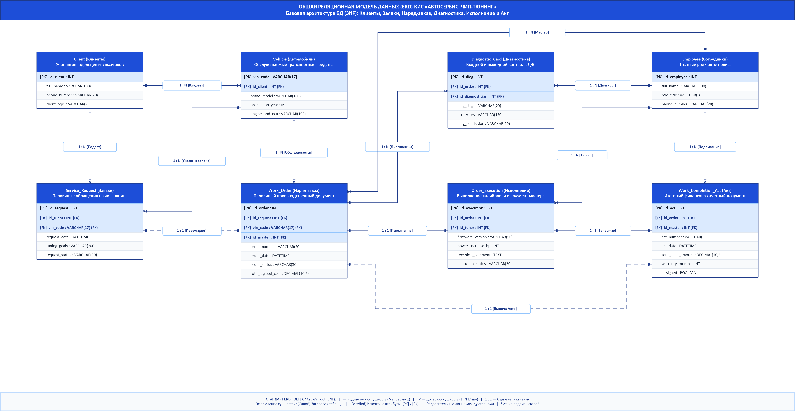

# Общая реляционная модель данных (ERD) КИС «Автосервис: Чип-тюнинг»
## Оптимизированная архитектура базы данных (Необходимый минимум, 3NF)

**Дисциплина:** Корпоративные информационные системы (КИС)  
**Университет:** ФГБОУ ВО «Уфимский университет науки и технологий» (УУНиТ), каф. АСУ  
**Преподаватель:** ст. преп. Демченко М.С.  
**Разработчики:** студенты гр. ЭАС-514С Гайнанов Данил и [Партнер] Карим  
**Год:** 2026  

---

## 1. Концепция и обоснование оптимизации модели

В соответствии с заданием преподавателя и требованиями к читаемости реляционной схемы разработана **оптимизированная общая модель данных (ERD)**, содержащая необходимый и достаточный минимум сущностей и атрибутов:
- **Сокращение избыточности:** количество таблиц уменьшено с 13 до **8 ключевых сущностей**, исключены промежуточные справочники и избыточные телеметрические поля;
- **Сквозная интеграция обоих этапов (Данил + Карим):**
  - **Контур Данила (Приемка и согласование):** регистрация клиента (`Client`), автомобиля (`Vehicle`), фиксация первичной заявки (`Service_Request`) и формирование утвержденного **Наряд-заказа** (`Work_Order`);
  - **Контур Карима (Производство и сдача):** входная/выходная диагностика ДВС (`Diagnostic_Card`), процесс калибровки с обязательным техническим комментарием мастера (`Order_Execution`) и закрытие заказа с выдачей **Акта выполненных работ** (`Work_Completion_Act`);
  - **Общесистемный контур:** учет сотрудников и их штатных ролей (`Employee`).
- **Соблюдение нормализации (3NF):** модель строго находится в 3-й нормальной форме, гарантируя целостность связей PK-FK без аномалий вставки, обновления и удаления.

---

## 2. Графическая схема в Microsoft Visio (нотация Crow's Foot / IDEF1X)

- **Файл проекта Microsoft Visio (.vsdx):** [ER_модель_КИС_ЧипТюнинг_Общая.vsdx](file:///c:/Users/danch/OneDrive/Рабочий%20стол/stage5/КИС/ER_модель_КИС_ЧипТюнинг_Общая.vsdx)
- **Изображение высокого разрешения (.png):** [ER_модель_КИС_ЧипТюнинг_Общая.png](file:///c:/Users/danch/OneDrive/Рабочий%20стол/stage5/КИС/ER_модель_КИС_ЧипТюнинг_Общая.png)

---

## 3. Спецификация 8 базовых сущностей базы данных

### 1. Таблица `Client` (Клиенты автосервиса)
Учет автовладельцев (физических лиц) и корпоративных заказчиков (юридических лиц).
| Поле | Тип данных | Ключ | Назначение |
| :--- | :--- | :---: | :--- |
| `id_client` | INT | **PK** | Уникальный код клиента (автоинкремент) |
| `full_name` | VARCHAR(100) | | ФИО владельца либо наименование организации |
| `phone_number` | VARCHAR(20) | | Контактный номер телефона для связи и оповещений |
| `client_type` | VARCHAR(20) | | Тип клиента («Физлицо», «Юрлицо») |

---

### 2. Таблица `Vehicle` (Обслуживаемые автомобили)
Хранение сведений о транспортном средстве, модификации двигателя и типе блока управления (ЭБУ).
| Поле | Тип данных | Ключ | Назначение |
| :--- | :--- | :---: | :--- |
| `vin_code` | VARCHAR(17) | **PK** | Международный 17-значный идентификационный номер (VIN) |
| `id_client` | INT | **FK** | Ссылка на владельца (`Client.id_client`) |
| `brand_model` | VARCHAR(100) | | Марка и модель (например, BMW 530d G30) |
| `production_year`| INT | | Год выпуска автомобиля |
| `engine_and_ecu` | VARCHAR(100) | | ДВС и модель ЭБУ (например, 3.0 B57 / Bosch MD1CS001) |

---

### 3. Таблица `Employee` (Сотрудники автосервиса)
Штатный персонал, ответственный за оформление документов, диагностику и калибровку.
| Поле | Тип данных | Ключ | Назначение |
| :--- | :--- | :---: | :--- |
| `id_employee` | INT | **PK** | Уникальный табельный номер сотрудника |
| `full_name` | VARCHAR(100) | | ФИО сотрудника |
| `role_title` | VARCHAR(50) | | Должность («Мастер-приемщик», «Диагност», «Тюнер-калибровщик») |
| `phone_number` | VARCHAR(20) | | Рабочий номер телефона |

---

### 4. Таблица `Service_Request` (Заявки клиентов — этап Данила)
Первичная регистрация обращения клиента на доработку программы управления двигателем.
| Поле | Тип данных | Ключ | Назначение |
| :--- | :--- | :---: | :--- |
| `id_request` | INT | **PK** | Уникальный номер входящей заявки |
| `id_client` | INT | **FK** | Ссылка на заказчика (`Client.id_client`) |
| `vin_code` | VARCHAR(17) | **FK** | Ссылка на автомобиль (`Vehicle.vin_code`) |
| `request_date` | DATETIME | | Дата и время поступления заявки |
| `tuning_goals` | VARCHAR(200) | | Пожелания клиента («Stage 1 + откл. EGR/DPF», «Евро-2») |
| `request_status`| VARCHAR(30) | | Статус («Новая», «На согласовании», «Утверждена») |

---

### 5. Таблица `Work_Order` (Наряд-заказ — ключевой документ Данила)
Главный производственный документ, фиксирующий объем работ, сроки и согласованную стоимость.
| Поле | Тип данных | Ключ | Назначение |
| :--- | :--- | :---: | :--- |
| `id_order` | INT | **PK** | Идентификатор наряд-заказа |
| `id_request` | INT | **FK** | Заявка-основание (`Service_Request.id_request`) |
| `vin_code` | VARCHAR(17) | **FK** | Автомобиль в работе (`Vehicle.vin_code`) |
| `id_master` | INT | **FK** | Ответственный мастер-приемщик (`Employee.id_employee`) |
| `order_number`| VARCHAR(30) | | Номер наряд-заказа (например, «НЗ-2026/04-118») |
| `order_date` | DATETIME | | Дата и время открытия наряд-заказа |
| `order_status`| VARCHAR(30) | | Статус («Открыт», «В работе», «Выполнен», «Закрыт») |
| `total_agreed_cost` | DECIMAL(10,2) | | Согласованная стоимость комплекса работ (руб.) |

---

### 6. Таблица `Diagnostic_Card` (Диагностическая карта)
Протокол компьютерной диагностики систем двигателя (входной контроль перед чип-тюнингом и выходной контроль).
| Поле | Тип данных | Ключ | Назначение |
| :--- | :--- | :---: | :--- |
| `id_diag` | INT | **PK** | Уникальный номер диагностической карты |
| `id_order` | INT | **FK** | Ссылка на наряд-заказ (`Work_Order.id_order`) |
| `id_diagnostician` | INT | **FK** | Проводивший диагностику специалист (`Employee.id_employee`) |
| `diag_stage` | VARCHAR(20) | | Этап («Входная», «Выходная») |
| `dtc_errors` | VARCHAR(150) | | Обнаруженные коды неисправностей OBD-II (или «Ошибок нет») |
| `diag_conclusion` | VARCHAR(50) | | Вердикт («Допущен к прошивке», «Требуется ремонт», «Норма») |

---

### 7. Таблица `Order_Execution` (Исполнение калибровки — этап Карима)
Фиксация технической реализации чип-тюнинга, версии загружаемого ПО и замечаний мастера.
| Поле | Тип данных | Ключ | Назначение |
| :--- | :--- | :---: | :--- |
| `id_execution` | INT | **PK** | Уникальный код операции калибровки |
| `id_order` | INT | **FK** | Наряд-заказ (`Work_Order.id_order`) |
| `id_tuner` | INT | **FK** | Инженер-калибровщик (`Employee.id_employee`) |
| `firmware_version` | VARCHAR(50) | | Версия калибровки (например, «Stage-1_v3.2_DynoTune») |
| `power_increase_hp` | INT | | Прирост мощности двигателя (л.с.) |
| `technical_comment` | TEXT | | **Обязательный комментарий мастера** (особенности записи, чексумма, адаптация АКПП) |
| `execution_status` | VARCHAR(30) | | Статус («В процессе записи», «Завершено успешно») |

---

### 8. Таблица `Work_Completion_Act` (Акт выполненных работ — ключевой документ Карима)
Итоговый финансово-отчетный документ, подтверждающий успешное завершение работ, оплату и гарантийные обязательства.
| Поле | Тип данных | Ключ | Назначение |
| :--- | :--- | :---: | :--- |
| `id_act` | INT | **PK** | Идентификатор акта сдачи-приемки |
| `id_order` | INT | **FK** | Наряд-заказ (`Work_Order.id_order`) |
| `id_master` | INT | **FK** | Мастер, подписавший акт (`Employee.id_employee`) |
| `act_number` | VARCHAR(30) | | Номер акта (например, «АКТ-2026/04-118») |
| `act_date` | DATETIME | | Дата и время подписания акта и выдачи автомобиля |
| `total_paid_amount` | DECIMAL(10,2) | | Фактически оплаченная сумма (руб.) |
| `warranty_months` | INT | | Срок гарантии на программное обеспечение (мес.) |
| `is_signed` | BOOLEAN | | Отметка о двухстороннем подписании клиентом и мастером |

---

## 4. Спецификация межтабличных связей (Реляционная целостность)

| № | Родительская таблица (1) | Дочерняя таблица (N/1) | Тип связи | Внешний ключ (FK) | Бизнес-смысл |
| :-: | :--- | :--- | :-: | :--- | :--- |
| 1 | `Client` | `Vehicle` | 1 : N | `Vehicle.id_client` | Один клиент может владеть несколькими автомобилями |
| 2 | `Client` | `Service_Request` | 1 : N | `Service_Request.id_client` | Клиент подает заявки на доработку автомобилей |
| 3 | `Vehicle` | `Service_Request` | 1 : N | `Service_Request.vin_code` | Автомобиль указывается в заявках на тюнинг |
| 4 | `Vehicle` | `Work_Order` | 1 : N | `Work_Order.vin_code` | Автомобиль проходит обслуживание по наряд-заказу |
| 5 | `Service_Request` | `Work_Order` | 1 : 1 | `Work_Order.id_request` | Утвержденная заявка порождает ровно один наряд-заказ |
| 6 | `Work_Order` | `Diagnostic_Card` | 1 : N | `Diagnostic_Card.id_order` | В рамках наряда проводятся входная и выходная диагностики |
| 7 | `Work_Order` | `Order_Execution` | 1 : 1 | `Order_Execution.id_order` | Наряд-заказ исполняется калибровщиком |
| 8 | `Order_Execution` | `Work_Completion_Act`| 1 : 1 | `Work_Completion_Act.id_order` | Завершение исполнения закрывается актом |
| 9 | `Work_Order` | `Work_Completion_Act`| 1 : 1 | `Work_Completion_Act.id_order` | Наряд-заказ юридически закрывается выдачей акта |
| 10 | `Employee` | `Work_Order` | 1 : N | `Work_Order.id_master` | Мастер-приемщик открывает и ведет наряд-заказ |
| 11 | `Employee` | `Diagnostic_Card` | 1 : N | `Diagnostic_Card.id_diagnostician`| Диагност выполняет тесты систем ДВС |
| 12 | `Employee` | `Order_Execution` | 1 : N | `Order_Execution.id_tuner` | Калибровщик прошивает ЭБУ и пишет комментарий |
| 13 | `Employee` | `Work_Completion_Act`| 1 : N | `Work_Completion_Act.id_master` | Мастер подписывает акт выполненных работ |

---

## 5. Преимущества упрощенной схемы
1. **Максимальная читаемость:** схема легко воспринимается на формате А4 / А3 и на экране проектора без микроскопического текста;
2. **Отсутствие пересечений линий:** ортогональная трассировка магистралей исключает прохождение стрелок через блоки сущностей;
3. **Строгое соответствие заданию:** сохранены оба ключевых документа («Наряд-заказ» Данила и «Акт выполненных работ» Карима), а также обязательный атрибут `technical_comment`.
