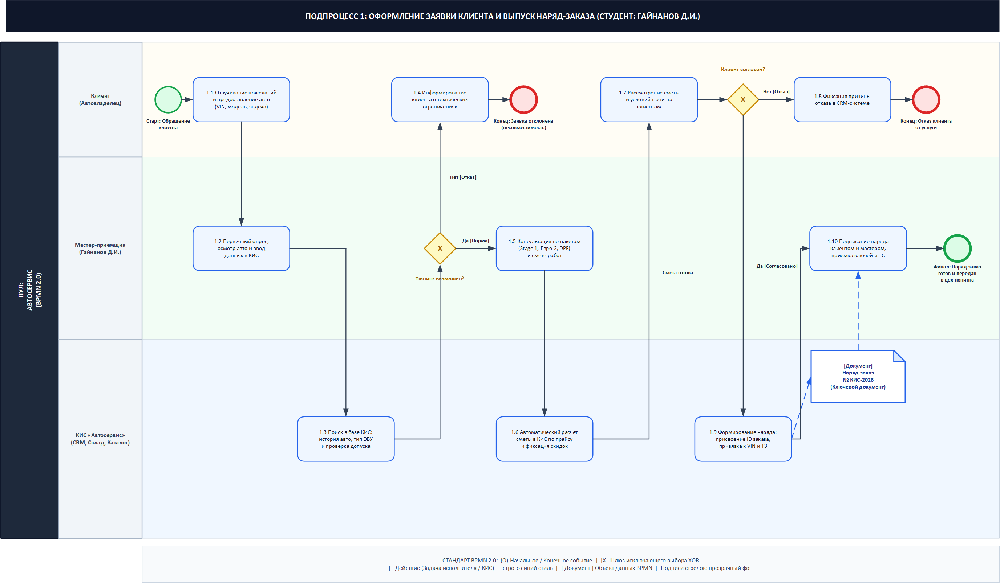
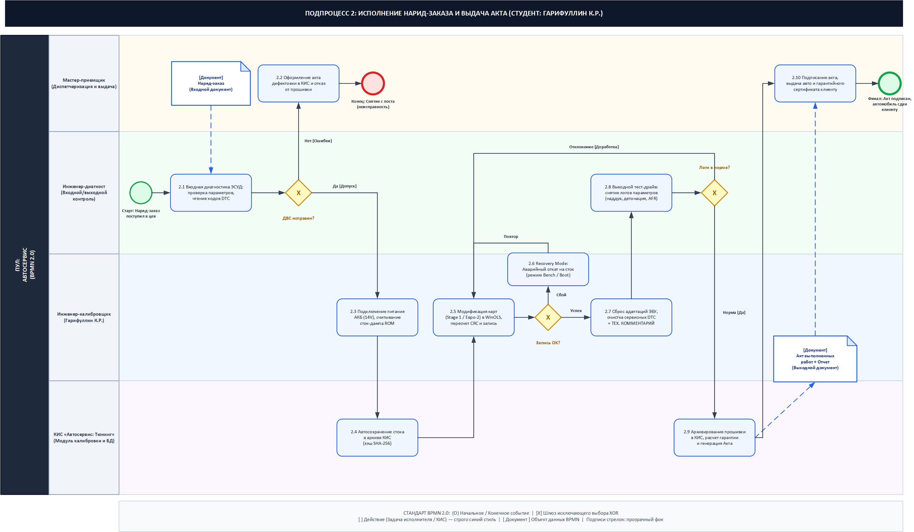
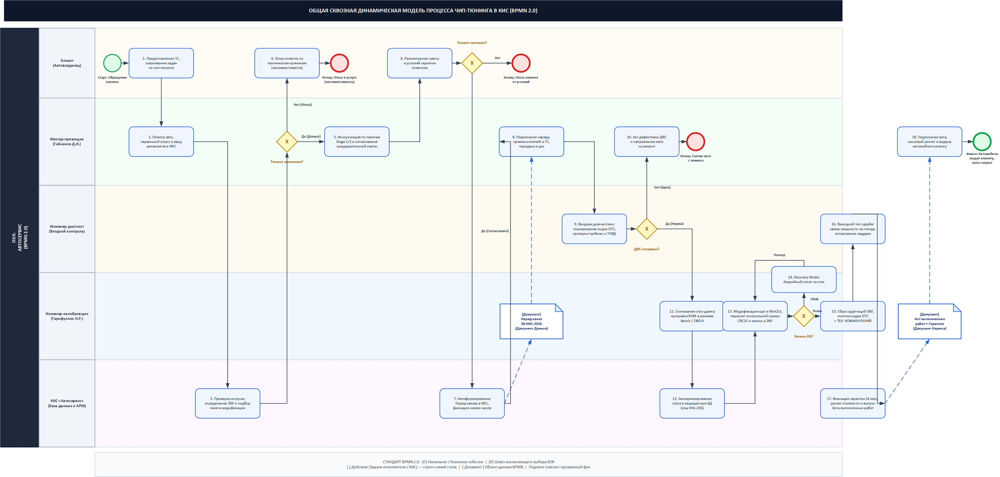
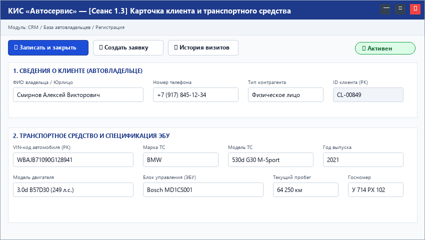
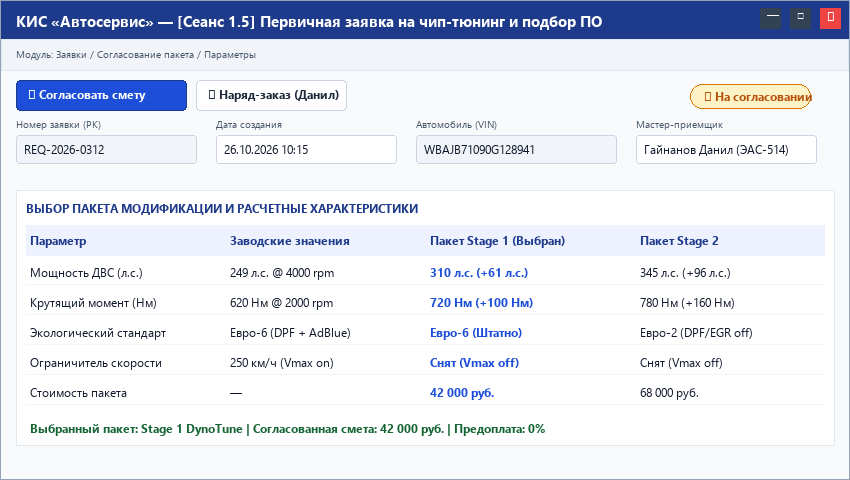
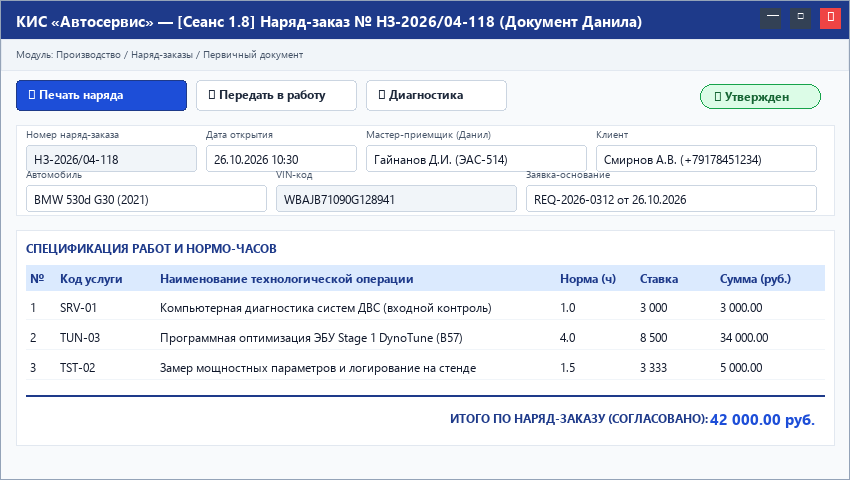
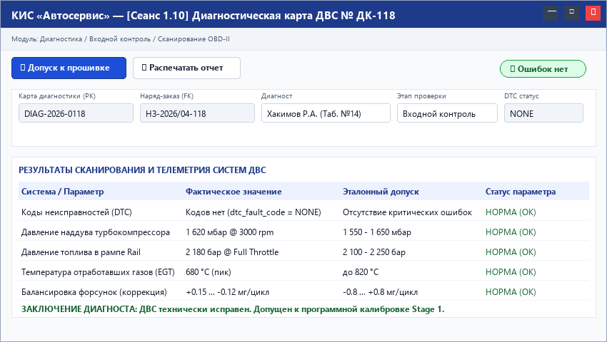
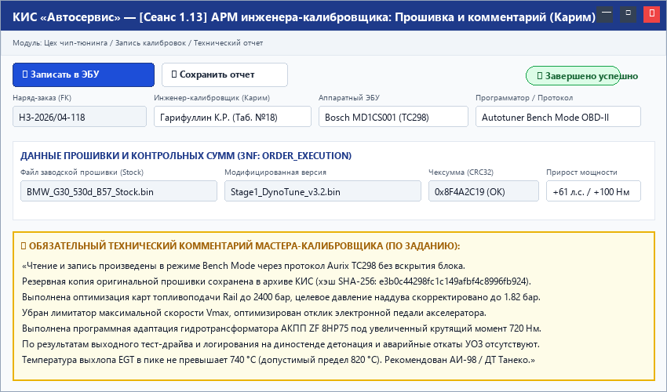
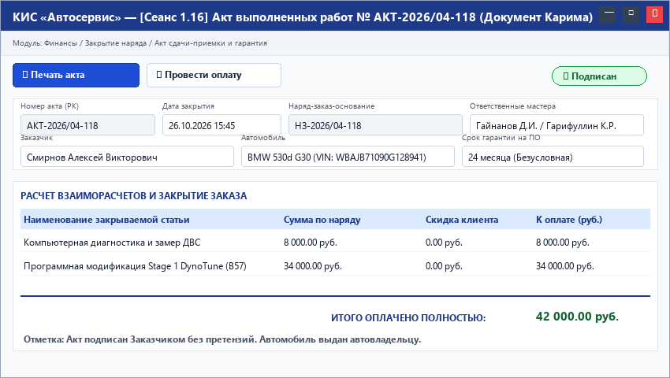
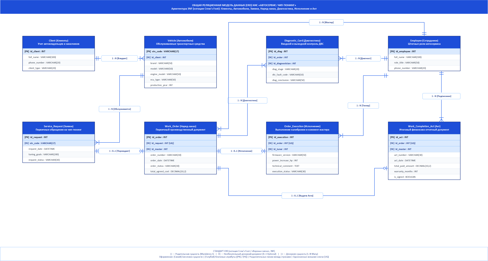

# Министерство науки и высшего образования Российской Федерации
## ФГБОУ ВО «Уфимский университет науки и технологий»
### Кафедра автоматизированных систем управления

---

# ОТЧЕТ ПО ЛАБОРАТОРНЫМ РАБОТАМ
## по дисциплине «Корпоративные информационные системы»
## ЧАСТЬ 2

### Тема: «Детальный бизнес-сценарий (ДБС) оказания услуг программной модификации блоков управления двигателем (чип-тюнинг) в КИС Автосервис»

**Выполнили:**  
студенты группы ЭАС-514С  
Гайнанов Д. И.  
Гарифуллин К. Р.  

**Проверил:**  
ст. преподаватель кафедры АСУ  
Демченко М. С.  

**Уфа — 2026 г.**

---

# ЗАДАНИЕ
### на лабораторные работы по дисциплине «Корпоративные информационные системы» ЧАСТЬ 2

| Студент | Гайнанов Д.И., Гарифуллин К.Р. | Группа | ЭАС-514С | Консультант | Демченко М.С. |
| :--- | :--- | :--- | :--- | :--- | :--- |
| | Фамилия И.О. | | номер группы | | Фамилия И.О. |

| Пункт задания | Содержание |
| :--- | :--- |
| 1. Тема | «Детальный бизнес-сценарий (ДБС) оказания услуг программной модификации блоков управления двигателем (чип-тюнинг) в КИС Автосервис» |
| 2. Основное содержание | В рамках лабораторных работ ЧАСТЬ 1 сформирована технико-экономическая характеристика объекта автоматизации и построена реляционная модель данных (ERD). В Части 2 разработан Детальный бизнес-сценарий сквозного процесса «Оказание услуг чип-тюнинга автомобиля» в соответствии с корпоративным шаблоном ДБС. Включены: общая схема БП на 5 ролей, матрица ответственности, пошаговая спецификация 7 ключевых шагов процесса с экранными формами (UI Mockups) и таблицами значимых атрибутов, требованиями к функционалу и интеграции. Все схемы разработаны в MS Visio. |
| 3. Исходные данные | Вариант комплексной автоматизации автосервиса чип-тюнинга и калибровки ЭБУ; результаты ЧАСТИ 1 (подпроцесс оформления заявки и утверждения наряд-заказа — Гайнанов Д.И.; подпроцесс исполнения наряд-заказа с комментарием мастера и выдачи акта — Гарифуллин К.Р.); нормативные документы СТО 521.18.107-2007, СТО 521.18.158-2018. |
| 4. Требования к оформлению | 4.1 Пояснительная записка к отчету оформляется в соответствии с СТП УГАТУ. Обязательно автособираемое Оглавление. 4.2 Разделы: Титульный лист, Лист Задания, Титульный лист ДБС, Оглавление, Термины и сокращения, 1. Версии документа, 2. Назначение документа, 3. Основные положения, 4. Бизнес-процесс, 5. Модель данных, Заключение, Список используемых источников. 4.3 Срок сдачи: 2026 г. |

Руководитель: __________________ М.С. Демченко          Студенты: _________________ Гайнанов Д.И., Гарифуллин К.Р.

---

# ООО «Тюнинг-Сервис Моторспорт»
### Департамент корпоративных информационных технологий

# ДЕТАЛЬНЫЙ БИЗНЕС-СЦЕНАРИЙ
## 123456BS 01
### «Оказание услуг программной модификации блоков управления двигателем (чип-тюнинг) в КИС Автосервис»

| Статус согласования | Должность / Роль | ФИО / Подпись | Дата |
| :--- | :--- | :--- | :--- |
| Утверждено: | Генеральный директор | Смирнов А.В. / ________ / | «___» _____ 2026 г. |
| Согласовано: | Руководитель проекта КИС | Демченко М.С. / ________ / | «___» _____ 2026 г. |
| Разработано: | Ведущий бизнес-аналитик | Гайнанов Д.И. / ________ / | «___» _____ 2026 г. |
| Разработано: | Ведущий инженер-калибровщик | Гарифуллин К.Р. / ________ / | «___» _____ 2026 г. |
| Направление: | Техническое обслуживание и тюнинг | КИС «Автосервис КОРП» | Версия 2.0 |

г. Уфа, 2026 г.

---

# Оглавление

- [Термины и сокращения](#термины-и-сокращения)
- [1 Версии документа](#1-версии-документа)
- [2 Назначение документа](#2-назначение-документа)
- [3 Основные положения](#3-основные-положения)
  - [3.1 Бизнес-цели](#31-бизнес-цели)
  - [3.2 Подход к реализации процесса](#32-подход-к-реализации-процесса)
  - [3.3 Концептуальные допущения и ограничения](#33-концептуальные-допущения-и-ограничения)
  - [3.4 Используемая функциональность](#34-используемая-функциональность)
- [4 Бизнес процесс «Оказание услуг программной модификации блоков управления двигателем (чип-тюнинг)»](#4-бизнес-процесс-оказание-услуг-программной-модификации-блоков-управления-двигателем-чип-тюнинг)
  - [4.1 Общая схема и роли по шагам бизнес-процесса](#41-общая-схема-и-роли-по-шагам-бизнес-процесса)
    - [4.1.1 Назначение БП](#411-назначение-бп)
    - [4.1.2 Схема БП](#412-схема-бп)
    - [4.1.3 Роли по шагам процесса (Матрица RACI)](#413-роли-по-шагам-процесса-матрица-raci)
  - [4.2 Описание шагов бизнес процесса](#42-описание-шагов-бизнес-процесса)
    - [4.2.1 Шаг 1. Первичная регистрация клиента и идентификация автомобиля](#421-шаг-1-первичная-регистрация-клиента-и-идентификация-автомобиля)
    - [4.2.2 Шаг 2. Формирование заявки и подбор конфигурации чип-тюнинга](#422-шаг-2-формирование-заявки-и-подбор-конфигурации-чип-тюнинга)
    - [4.2.3 Шаг 3. Согласование и утверждение Наряд-заказа (Подпроцесс Данила)](#423-шаг-3-согласование-и-утверждение-наряд-заказа-подпроцесс-данила)
    - [4.2.4 Шаг 4. Входная компьютерная диагностика систем ДВС и ЭБУ](#424-шаг-4-входная-компьютерная-диагностика-систем-двс-и-эбу)
    - [4.2.5 Шаг 5. Считывание стоковой прошивки, калибровка и запись модифицированного ПО с фиксацией технического комментария (Подпроцесс Карима)](#425-шаг-5-считывание-стоковой-прошивки-калибровка-и-запись-модифицированного-по-с-фиксацией-технического-комментария-подпроцесс-карима)
    - [4.2.6 Шаг 6. Выходная диагностика, динамические замеры и верификация параметров](#426-шаг-6-выходная-диагностика-динамические-замеры-и-верификация-параметров)
    - [4.2.7 Шаг 7. Формирование и выдача Акта выполненных работ, гарантийного сертификата и взаиморасчет (Подпроцесс Карима)](#427-шаг-7-формирование-и-выдача-акта-выполненных-работ-гарантийного-сертификата-и-взаиморасчет-подпроцесс-карима)
- [5 Структура информационной базы и модель данных (ER-диаграмма)](#5-структура-информационной-базы-и-модель-данных-er-диаграмма)
- [Заключение](#заключение)
- [Список используемых источников](#список-используемых-источников)

---

# Термины и сокращения

Использованные в настоящем документе детального бизнес-сценария термины и сокращения трактуются следующим образом:

| Термин / Сокращение | Описание и смысловое значение |
| :--- | :--- |
| **КИС** | Корпоративная информационная система — комплексное прикладное программное обеспечение для автоматизации операционного учета, документооборота, планирования ресурсов и взаимодействия подразделений автосервиса. |
| **ДБС** | Детальный бизнес-сценарий — проектный регламентирующий документ, описывающий последовательность шагов бизнес-процесса, ролевую модель, пользовательские сеансы, атрибутивный состав данных и интеграционные взаимодействия. |
| **ЭБУ / ECU** | Электронный блок управления (Engine Control Unit) — микропроцессорный контроллер, управляющий впрыском топлива, зажиганием, наддувом турбокомпрессора и экологическими подсистемами ДВС. |
| **Чип-тюнинг** | Программная модификация калибровочных таблиц заводской прошивки ЭБУ с целью повышения мощности, крутящего момента, оптимизации топливной экономичности или программного отключения экологических компонентов (EGR, DPF, AdBlue, SAP). |
| **Stage 1 / Stage 2** | Градации уровней программной модификации. Stage 1 — оптимизация заводского ПО под стандартные узлы ДВС. Stage 2 — калибровка под модифицированные компоненты (downpipe, спортивный интеркулер, впуск). |
| **Дамп прошивки (ROM/BIN)** | Полный бинарный образ микрокода и калибровочных карт флеш-памяти и микроконтроллера ЭБУ (размер от 512 КБ до 8 МБ). |
| **Контрольная сумма (Checksum)** | Математический хэш-код целостности бинарного файла прошивки, верифицируемый процессором ЭБУ при запуске для предотвращения сбоев и блокировки процессора. |
| **Наряд-заказ (Work Order)** | Первичный юридический и финансовый документ, фиксирующий перечень заказанных работ, калькуляцию стоимости, согласие клиента на проведение вмешательства и плановые сроки (зона ответственности Данила). |
| **АРМ Калибровщика** | Автоматизированное рабочее место инженера-калибровщика в КИС, интегрированное со специализированными аппаратными загрузчиками и редактором калибровок WinOLS. |
| **Технический комментарий** | Обязательное поле фиксации инженерных нюансов, параметров наддува, УОЗ, температуры выхлопных газов (EGT) и поведения ЭБУ мастером-калибровщиком (зона ответственности Карима). |
| **Акт выполненных работ** | Заключительный юридический документ, фиксирующий фактическое исполнение работ, факт передачи ключей и автомобиля владельцу, выдачу гарантийного талона на прошивку (зона ответственности Карима). |
| **СТО / СТП** | Стандарты предприятия и стандарты организации системы менеджмента качества (в том числе СТО 521.18.107-2007 и СТО 521.18.158-2018). |

---

# 1 Версии документа

В таблице 1 приведена хронология разработки и согласования настоящего детального бизнес-сценария.

Таблица 1 — История версий документа ДБС

| Дата | Автор | Компания / Группа | Версия | Описание изменений |
| :---: | :--- | :---: | :---: | :--- |
| 15.02.2026 | Гайнанов Д.И. | ЭАС-514С | 1.0 | Первоначальная редакция: формирование бизнес-целей, структуры БП и матрицы ролей. |
| 28.02.2026 | Гарифуллин К.Р. | ЭАС-514С | 1.1 | Детализация шагов исполнения наряд-заказа, добавление интерфейса АРМ калибровщика и технического комментария. |
| 20.03.2026 | Гайнанов Д.И., Гарифуллин К.Р. | ЭАС-514С | 2.0 | Итоговая интеграция: ER-диаграмма в 3NF, валидация экранных форм UI mockups, согласование с кафедрой АСУ. |

---

# 2 Назначение документа

Настоящий документ разработан в рамках выполнения лабораторных работ по дисциплине «Корпоративные информационные системы» в 2026 году. Предметная область: «Автоматизация технологических и управленческих процессов автосервиса чип-тюнинга двигателей и калибровки блоков управления».

Настоящий документ 123456BS 01 «Оказание услуг программной модификации блоков управления двигателем (чип-тюнинг) в КИС Автосервис» содержит детальный бизнес-сценарий по направлению сервисного и технологического обслуживания и является ключевым проектным документом этапа функционального моделирования.

В документе регламентированы процессы взаимодействия клиентов, мастеров приемки, диагностов, калибровщиков и финансового отдела в корпоративной информационной системе «Автосервис КОРП» на базе платформы «1С:Предприятие 8.3». Приводится строгая хронологическая последовательность шагов, детальная ролевая спецификация, перечень входов и выходов, требования к экранным сеансам КИС и перечень значимых атрибутов базы данных.

Структура документа включает:
— индивидуальные динамические модели подпроцессов оформления заявки (Гайнанов Д.И.) и исполнения наряд-заказа с комментарием мастера (Гарифуллин К.Р.) в стандарте BPMN 2.0;
— общую сквозную динамическую модель процесса оказания услуг чип-тюнинга по 5 ролевым дорожкам;
— матрицу распределения ответственности ролей по шагам технологического цикла (RACI);
— пошаговую спецификацию 7 базовых этапов с макетами экранных форм (UI Mockups);
— таблицы атрибутивного состава заполняемых экранных сеансов и первичных документов;
— требования к доработке типовой функциональности КИС и внешним интеграционным шлюзам;
— логическую реляционную модель данных (ERD) в третьей нормальной форме.

---

# 3 Основные положения

## 3.1 Бизнес-цели

Основными бизнес-целями автоматизации процесса оказания услуг чип-тюнинга являются:
— сокращение общего времени цикла обслуживания одного автомобиля с 5–6 часов до 2–3 часов за счет параллелизации диагностики, электронной передачи стокового дампа прошивки и автоматического формирования наряд-заказов;
— 100% исключение рисков повреждения дорогостоящих электронных блоков управления (ECU) и двигателей благодаря обязательному аппаратному гейткипингу — проведению входной компьютерной диагностики до этапа чтения прошивки;
— гарантированное сохранение оригинальных заводских калибровок (стоковых дампов) в централизованном защищенном архиве КИС с привязкой к VIN-номеру автомобиля и расчетной контрольной суммы (Checksum);
— обеспечение сквозной юридической и финансовой прозрачности отношений с клиентом путем автоматической генерации электронного Наряд-заказа (ответственный: Данил) и финального Акта выполненных работ с гарантией (ответственный: Карим);
— снижение трудоемкости рутинных операций оформления документов на 65% и исключение ошибок ручного ввода данных об автомобиле и клиенте.

## 3.2 Подход к реализации процесса

В основу концептуального подхода к реализации процесса положена сервисно-ориентированная сквозная цепочка создания ценности (End-to-End Service Flow), охватывающая жизненный цикл заявки от первичного обращения автовладельца до выезда модифицированного автомобиля из бокса:
— четкое разграничение зон ответственности между сервисным отделом (мастер-приемщик, Гайнанов Д.И.) и инженерно-техническим производственным цехом (инженер-калибровщик, Гарифуллин К.Р.);
— использование единого сквозного идентификатора заказа (id_order), гарантирующего целостность данных от заявки до бухгалтерской проводки и гарантийного сертификата;
— шлюзовый контроль качества (Quality Gate): система программно блокирует переход наряд-заказа в статус «В работе у калибровщика», если в КИС не прикреплена подписанная электронная Диагностическая карта со статусом «ДВС исправен» (dtc_errors_found = False);
— обязательное протоколирование инженерных параметров модификации (калибровки наддува, топливоподачи, УОЗ) в виде структурированного «Технического комментария мастера» непосредственно в АРМ калибровщика КИС.

## 3.3 Концептуальные допущения и ограничения

Бизнес-сценарий учитывает основные требования нормативной документации и стандартов предприятия системы менеджмента качества (СМК):
— СТО 521.18.107-2007 «Система менеджмента качества. Изделия основного производства. Мероприятия по устранению и предупреждению дефектов» — регламентирует обязательность входного диагностического контроля параметров ДВС;
— СТО 521.18.158-2018 «Система менеджмента качества. Детали, сборочные единицы изделий. Оформление решений на выпуск деталей, сборочных единиц с отклонениями от требований конструкторской документации» — регламентирует порядок фиксации отклонений и калибровочных изменений в техническом комментарии мастера;
— ГОСТ 33997-2016 «Колесные транспортные средства. Требования к безопасности в эксплуатации и методы проверки»;
— технологическое ограничение: при обнаружении критических кодов ошибок DTC (пропуски зажигания, детонация, отклонение давления наддува более 10%, критическая коррекция топливоподачи LTFT > 15%) автомобиль категорически снимается с программного тюнинга и перенаправляется на механический ремонт.

## 3.4 Используемая функциональность

В качестве базовой платформы автоматизации выбрана конфигурация «1С:Предприятие 8.3 КОРП: Автосервис», расширенная специализированными модулями управления чип-тюнингом. Функциональность сгруппирована по следующим подсистемам:
— подсистема «CRM и Продажи»: ведение карточек контрагентов, клиентской базы, парка автомобилей, регистрация первичных заявок и подбор пакетов калибровок (Stage 1 / Stage 2);
— подсистема «Приемка и Документооборот»: формирование, калькуляция и утверждение электронных Наряд-заказов (Work Order), оформление предварительного согласия клиента (зона Данила);
— подсистема «Техническая диагностика»: регистрация протоколов входного и выходного компьютерного сканирования ЭБУ, импорт отчетов диагностических сканеров Launch/VCDS/Autel;
— подсистема «Тюнинг-производство (АРМ Калибровщика)»: управление жизненным циклом прошивок, защищенное бинарное хранилище дампов, интеграция с программаторами, фиксация контрольных сумм и инженерного технического комментария (зона Карима);
— подсистема «Финансы и Взаиморасчеты»: кассовый расчет (наличные, эквайринг, СБП), печать фискальных чеков по 54-ФЗ, генерация финального Акта выполненных работ и печать гарантийного сертификата (зона Карима).

---

# 4 Бизнес процесс «Оказание услуг программной модификации блоков управления двигателем (чип-тюнинг)»

## 4.1 Назначение и концепция бизнес-процесса

Бизнес-процесс «Оказание услуг программной модификации блоков управления двигателем (чип-тюнинг)» описывает регламентированную последовательность процедур и транзакций по взаимодействию персонала сервисного центра при регистрации клиента, согласовании объема доработок, входной инструментальной проверке ДВС, безопасной перезаписи управляющей микропрограммы контроллера, верификации динамических параметров и окончательном расчете с оформлением гарантийных обязательств.

Участниками и исполнителями по данному процессу являются:
— Клиент (автовладелец или его законный представитель);
— Мастер-приемщик (ведущий менеджер по работе с клиентами — студент Гайнанов Д.И.);
— Инженер-диагност (специалист входного и выходного аппаратного контроля);
— Инженер-калибровщик (технический специалист цеха тюнинга — студент Гарифуллин К.Р.);
— Бухгалтер-кассир (специалист финансово-расчетного сектора);
— КИС «Автосервис КОРП» (информационная подсистема маршрутизации, электронного документооборота и защищенного хранения калибровок).

Ключевой вход процесса: личное обращение клиента с автомобилем, требующим программной настройки (Stage 1 / Stage 2, отключение экологических подсистем Евро-2, DPF, EGR, AdBlue).

Ключевой выход процесса: автомобиль с верифицированным калибровочным софтом, сохраненный стоковый дамп в архиве КИС, подписанный сторонами электронный Акт выполненных работ с техническим комментарием мастера, фискальный кассовый чек и гарантийный сертификат на 24 месяца.

## 4.2 Индивидуальные динамические модели подпроцессов (BPMN 2.0)

В соответствии с распределением функциональных зон ответственности между разработчиками детального бизнес-сценария, процесс декомпозирован на два сквозных технологических подпроцесса, оформленных в строгом стандарте BPMN 2.0 в среде MS Visio:
— Подпроцесс 1: «Оформление заявки клиента и выпуск наряд-заказа» (зона ответственности студента Гайнанова Д.И.);
— Подпроцесс 2: «Исполнение наряд-заказа, калибровка с комментарием мастера и выдача акта» (зона ответственности студента Гарифуллина К.Р.).

### 4.2.1 Подпроцесс 1. Оформление заявки клиента и выпуск наряд-заказа (Гайнанов Д.И.)

Подпроцесс 1 регламентирует сервисно-коммуникационный этап взаимодействия с клиентом. Модель охватывает 3 функциональные дорожки (Клиент, Мастер-приемщик Гайнанов Д.И., КИС «Автосервис»), 10 технологических процедур (шаги 1.1–1.10), шлюзы проверки технической применимости и согласования сметы, а также ключевой выходной артефакт — электронный Наряд-заказ (документ Work_Order).

Порядок исполнения подпроцесса 1:
— Шаги 1.1–1.2: Автовладелец обращается на станцию и формулирует технические требования (прирост динамики, снятие ограничителя скорости). Мастер-приемщик Гайнанов Д.И. производит визуальный осмотр, фиксирует пробег и инициирует сеанс в КИС;
— Шаги 1.3–1.4: КИС производит автоматический опрос истории обслуживания авто по VIN-номеру и сопоставляет модель ЭБУ со справочником доступных протоколов. В случае неподдерживаемого типа ЭБУ (шлюз «Тюнинг возможен?» -> «Нет») формируется отказ с регистрацией причины в CRM;
— Шаги 1.5–1.6: Мастер консультирует клиента по пакетам калибровок (Stage 1 или Stage 2). КИС рассчитывает сметную стоимость, нормативную трудоемкость и формирует проект документа;
— Шаги 1.7–1.8: Клиент знакомится со сметой и условиями гарантии. При несогласии автовладельца (шлюз «Клиент согласен?» -> «Нет») процесс завершается отказом;
— Шаги 1.9–1.10: При акцепте условий КИС регистрирует документ «Наряд-заказ № КИС-2026». Стороны подписывают соглашение, мастер принимает ключи и направляет автомобиль на диагностический пост.

  
Рисунок 1 — Динамическая модель подпроцесса 1: Оформление заявки клиента и выпуск наряд-заказа (Гайнанов Д.И., BPMN 2.0)

### 4.2.2 Подпроцесс 2. Исполнение наряд-заказа, калибровка с комментарием мастера и выдача акта (Гарифуллин К.Р.)

Подпроцесс 2 охватывает инженерно-производственный цикл: входной контроль исправности агрегатов, вычитывание оригинальной заводской прошивки, калибровку карт в WinOLS, безопасное перепрограммирование ЭБУ, обязательное протоколирование параметров настройки мастером, выходные динамические замеры и финансово-юридическое закрытие наряда. Модель включает 4 функциональные дорожки (Мастер-приемщик, Инженер-диагност, Инженер-калибровщик Гарифуллин К.Р., КИС «Автосервис: Тюнинг»), 10 технологических процедур (шаги 2.1–2.10) и ветвления по качеству.

Порядок исполнения подпроцесса 2:
— Шаги 2.1–2.2: Входной инструментальный контроль. Инженер-диагност опрашивает память ЭБУ сканером. При наличии активных кодов ошибок DTC (шлюз «ДВС исправен?» -> «Нет») оформляется акт дефектовки, наряд-заказ блокируется и авто направляется на механический ремонт;
— Шаги 2.3–2.4: При отсутствии неисправностей автомобиль передается инженеру Гарифуллину К.Р. Подключается стабилизированный источник питания (14.2 В). Вычитывается бинарный дамп заводской программы (ROM). КИС автоматически вычисляет хэш-сумму SHA-256 и архивирует стоковый файл в защищенное хранилище;
— Шаги 2.5–2.6: Калибровщик производит редактирование таблиц зажигания, топливоподачи и наддува в среде WinOLS. Рассчитывается контрольная сумма (Checksum) и выполняется запись микрокода во флеш-память. При аппаратном сбое записи активируется аварийная процедура Recovery Mode для восстановления блока;
— Шаг 2.7: Инженер-калибровщик Гарифуллин К.Р. производит адаптацию дроссельной заслонки и заносит в КИС развернутый «Технический комментарий мастера» (фактическое давление наддува, отсутствие детонации, требования к бензину АИ-98/100);
— Шаг 2.8: Совместно с диагностом выполняется тестовый заезд и логгирование наддува и смеси под нагрузкой. При соответствии параметров норме (шлюз «Логи в норме?» -> «Да») формируется заключение;
— Шаги 2.9–2.10: КИС генерирует выходной «Акт выполненных работ» и гарантийный талон на 24 месяца. Мастер и клиент подписывают Акт, кассир регистрирует оплату, и автомобиль передается владельцу.

  
Рисунок 2 — Динамическая модель подпроцесса 2: Исполнение наряд-заказа, калибровка с техническим комментарием мастера и выдача акта (Гарифуллин К.Р., BPMN 2.0)

## 4.3 Общая сквозная динамическая модель процесса чип-тюнинга (BPMN 2.0, 5 дорожек)

Общая сквозная динамическая модель объединяет подпроцессы оформления заявки (Гайнанов Д.И.) и исполнения наряд-заказа (Гарифуллин К.Р.) в единую сервисную цепочку автосервиса. Схема разработана в MS Visio в нотации BPMN 2.0 с соблюдением единого корпоративного стиля:
— синее колористическое оформление блоков действий (заливка RGB 239, 246, 255, граница RGB 37, 99, 235);
— типизированные объекты данных BPMN в форме документов со скошенным уголком ([Документ: Наряд-заказ] и [Документ: Акт выполненных работ]);
— прозрачный фон текстовых меток стрелок и шлюзов;
— 5 сквозных горизонтальных ролевых дорожек: Клиент (Автовладелец), Мастер-приемщик (Гайнанов Д.И.), Инженер-диагност (Входной контроль), Инженер-калибровщик (Гарифуллин К.Р.), КИС «Автосервис» (База данных и АРМ).

  
Рисунок 3 — Общая сквозная динамическая модель процесса оказания услуг чип-тюнинга в КИС (BPMN 2.0, 5 ролевых дорожек)

Сквозной процесс охватывает 18 процедурных шагов:
1. Клиент озвучивает пожелания по тюнингу и предоставляет автомобиль на станцию;
2. Мастер-приемщик осматривает ТС и заносит реквизиты в КИС (Сеанс 1.3);
3. КИС проверяет историю авто, модель ЭБУ и допуск к тюнингу;
4. При несовместимости ЭБУ (шлюз «Тюнинг возможен?» -> Нет) формируется отказ клиенту;
5. Мастер-приемщик подбирает тюнинг-пакет и рассчитывает смету (Сеанс 1.5);
6. Клиент рассматривает условия и смету;
7. При согласии клиента КИС формирует электронный Наряд-заказ;
8. Стороны подписывают Наряд-заказ (Сеанс 1.8, зона Данила), авто передается в цех;
9. Диагност проводит входное сканирование ДВС и проверку кодов DTC (Сеанс 1.10);
10. При обнаружении неисправностей (шлюз «ДВС исправен?» -> Нет) оформляется дефектовка и снятие авто с тюнинга;
11. При исправном ДВС калибровщик вычитывает стоковый дамп ROM в режиме Bench/OBD-II;
12. КИС автоматически сохраняет стоковый файл в защищенный архив с хэшем SHA-256;
13. Калибровщик оптимизирует карты в WinOLS, пересчитывает контрольные суммы и записывает софт в ЭБУ;
14. При сбое прошивки активируется аварийный режим Recovery Mode;
15. Мастер сбрасывает адаптации и вносит обязательный «Технический комментарий мастера» в АРМ (Сеанс 1.13, зона Карима);
16. Проводится выходной тест-драйв со снятием логов телеметрии и замером ВСХ;
17. КИС рассчитывает гарантию 24 месяца и генерирует Акт выполненных работ;
18. Мастер принимает оплату, стороны подписывают Акт (Сеанс 1.16, зона Карима), авто выдается владельцу.

## 4.4 Матрица распределения ответственности ролей по шагам процесса (RACI)

В таблице 2 приведена матрица распределения ответственности ролей по 7 ключевым технологическим шагам процесса в соответствии с методологией RACI (О — Ответственный, И — Исполнитель, С — Согласующий, У — Уведомляемый).

Таблица 2 — Матрица ответственности ролей по шагам процесса (RACI)

| Шаги бизнес-процесса | Клиент | Мастер (Данил) | Диагност | Калибровщик (Карим) | Кассир |
| :--- | :---: | :---: | :---: | :---: | :---: |
| Шаг 1. Регистрация клиента и ТС (Сеанс 1.3) | С | О / И | — | — | — |
| Шаг 2. Подбор тюнинг-пакета (Сеанс 1.5) | С | О / И | — | У | — |
| Шаг 3. Утверждение Наряд-заказа (Сеанс 1.8, Данил) | С | О / И | — | У | У |
| Шаг 4. Входная диагностика ДВС (Сеанс 1.10) | У | С | О / И | С | — |
| Шаг 5. Калибровка ЭБУ и коммент (Сеанс 1.13, Карим) | — | У | — | О / И | — |
| Шаг 6. Выходная диагностика и замеры (Сеанс 1.15) | — | У | И | О / И | — |
| Шаг 7. Выдача Акта и взаиморасчет (Сеанс 1.16, Карим) | С | И | — | О | О / И |

---

## 4.5 Описание шагов бизнес процесса

### 4.5.1 Шаг 1. Первичная регистрация клиента и идентификация автомобиля

Таблица 3 — Спецификация шага 1 «Регистрация клиента и ТС»

| Элемент | Описание |
| :--- | :--- |
| **Условия выполнения** | Личное прибытие клиента в сервисный центр или заявка с сайта. Отсутствие карточки клиента в базе данных КИС. |
| **Исполнитель** | Мастер-приемщик (зона ответственности Данила — Гайнанов Д.И.) |
| **Вход** | Паспортные данные клиента, свидетельство о регистрации ТС (СТС / ПТС), физический доступ к автомобилю. |
| **Выход** | Созданный и валидированный элемент справочника «Клиенты» (id_client) и справочника «Автомобили» (vin_code) в КИС Автосервис. |

#### Назначение
Идентификация контрагента, установление правомочности распоряжения транспортным средством, автоматическое определение модификации блока управления двигателем по каталогу VIN-кодов и привязка истории обслуживания к единому профилю автовладельца в КИС.

#### Описание действий
Мастер-приемщик открывает в КИС сеанс «Регистрация клиента и автомобиля» (Сеанс 1.3). Вводит ФИО, телефон и e-mail. Сканирует VIN-код из СТС (или считывает штрихкод сканером). Система производит декодирование VIN-кода: определяет марку, модель, год выпуска, буквенный код двигателя, установленную трансмиссию и базовую модель ЭБУ (например, Bosch MED17.5.2). При успешной валидации карточка сохраняется в базе данных.

  
Рисунок 4 — Экранная форма КИС «Регистрация клиента и автомобиля» (Сеанс 1.3)

Таблица 4 — Значимые атрибуты сеанса «Регистрация клиента и ТС»

| Атрибут | Описание | Рекомендации по заполнению |
| :--- | :--- | :--- |
| id_client | Уникальный идентификатор контрагента | Генерируется автоматически системой (GUID / автоинкремент). |
| client_fio | Полное имя клиента / представителя | Строка, ввод с документа удостоверяющего личность. |
| phone_number | Контактный номер мобильного телефона | Маска ввода +7 (XXX) XXX-XX-XX, используется для SMS-оповещений. |
| vin_code | Идентификационный номер ТС (VIN) | 17-значный уникальный код стандарта ISO 3779. Проверка контрольного символа. |
| brand_model | Марка и модификация автомобиля | Заполняется автоматически из VIN-декодера (например, BMW 330i G20). |
| engine_model | Модель двигателя и объем | Выбирается из базы двигателей (например, 2.0 B48B20 258 л.с.). |
| ecu_type | Тип установленного контроллера ЭБУ | Справочник ЭБУ (например, Bosch MG1CS024 / Continental SIMOS 18.1). |

#### Требуемое изменение функциональности
Внедрить модуль автоматического парсинга VIN-номеров через облачный API AutoData / TecDoc с автозаполнением полей типа ЭБУ и протокола программирования.

#### Требования к интеграции с другими системами
Направление: исходящий REST API запрос к сервису VIN-декодера; входящий JSON ответ. Частота: On-demand (по событию ввода VIN).

---

### 4.5.2 Шаг 2. Формирование заявки и подбор конфигурации чип-тюнинга

Таблица 5 — Спецификация шага 2 «Формирование заявки и подбор пакета»

| Элемент | Описание |
| :--- | :--- |
| **Условия выполнения** | Зарегистрированный клиент и автомобиль в КИС; наличие актуального каталога прошивок. |
| **Исполнитель** | Мастер-приемщик (Гайнанов Д.И.) |
| **Вход** | Пожелания клиента по характеристикам (прирост мощности, динамика, снятие лимитера скорости, экология). |
| **Выход** | Сформированная электронная заявка со статусом «Сформирована» (документ Service_Request). |

#### Назначение
Фиксация потребностей автовладельца, формализация требований к калибровке ДВС и подбор конкретной технической конфигурации тюнинг-пакета (Stage 1 / Stage 2) с расчетом расчетной прибавки мощности и крутящего момента.

#### Описание действий
Мастер открывает сеанс «Оформление заявки на чип-тюнинг» (Сеанс 1.5). Выбирает ранее зарегистрированного клиента. Из справочника пакетов тюнинга подбирает вариант: Stage 1 (программная настройка штатного мотора, +52 л.с., +90 Нм) либо Stage 2 (настройка под спортивный даунпайп). При необходимости отмечаются дополнительные опции: «Отключение вихревых заслонок», «Отключение контроля катализатора Euro-2», «Pop & Bang (отстрелы)». Система рассчитывает предварительную стоимость.

  
Рисунок 5 — Экранная форма КИС «Оформление заявки на чип-тюнинг» (Сеанс 1.5)

Таблица 6 — Значимые атрибуты сеанса «Заявка на чип-тюнинг»

| Атрибут | Описание | Рекомендации по заполнению |
| :--- | :--- | :--- |
| id_request | Номер заявки на обслуживание | Автоинкрементный уникальный системный номер заявки. |
| package_type | Категория тюнинг-пакета | Выбор из перечисления: Stage 1, Stage 2, EcoTuning, Custom. |
| power_gain_hp | Расчетный прирост мощности (л.с.) | Автоматически подтягивается из справочника Tuning_Package. |
| torque_gain_nm | Расчетный прирост крутящего момента (Нм) | Автоматически подтягивается из справочника Tuning_Package. |
| eco_options | Опции модификации экологии | Множественный выбор чекбоксов: Decat, DPF off, EGR off, AdBlue off. |
| preliminary_cost | Предварительная расчетная стоимость | Сумма пакета и дополнительных программных модулей (руб.). |

#### Требуемое изменение функциональности
Настройка правил валидации: запрет выбора Stage 2 без предварительной отметки об установке модифицированной выхлопной системы и интеркулера.

#### Требования к интеграции с другими системами
Н/П (внутренний функционал КИС).

---

### 4.5.3 Шаг 3. Согласование и утверждение Наряд-заказа (Подпроцесс Данила)

Таблица 7 — Спецификация шага 3 «Утверждение Наряд-заказа»

| Элемент | Описание |
| :--- | :--- |
| **Условия выполнения** | Сформированная заявка Service_Request, согласие клиента с предварительными условиями и стоимостью. |
| **Исполнитель** | Мастер-приемщик (Гайнанов Д.И. — ключевой итоговый документ этапа оформления заявки) |
| **Вход** | Электронная заявка id_request, согласованный перечень работ и материалов. |
| **Выход** | Утвержденный и подписанный клиентом Наряд-заказ (документ Work_Order) со статусом «Утвержден». |

#### Назначение
Юридическое и финансовое закрепление договоренностей между автосервисом и клиентом. Наряд-заказ выступает договором подряда на выполнение чип-тюнинга, фиксирует плановые сроки сдачи автомобиля, предельную смету и согласие владельца на перепрограммирование ЭБУ.

#### Описание действий
На основании заявки мастер Гайнанов Д.И. открывает сеанс «Наряд-заказ на обслуживание» (Сеанс 1.8). Система автоматически связывает наряд-заказ с id_request (исключая прямое дублирование vin_code для сохранения 3NF). Мастер назначает плановое время выдачи автомобиля, ответственного инженера-калибровщика и калькулирует итоговую стоимость. Документ выводится на двухстороннюю печать (или отправляется на электронный планшет подписи). Клиент ставит подпись, подтверждая ознакомление с регламентом. Статус документа в КИС переключается на «Утвержден к исполнению».

  
Рисунок 6 — Экранная форма КИС «Утверждение Наряд-заказа» (Сеанс 1.8 — зона ответственности Данила)

Таблица 8 — Значимые атрибуты сеанса «Наряд-заказ»

| Атрибут | Описание | Рекомендации по заполнению |
| :--- | :--- | :--- |
| id_order | Номер наряд-заказа (Work Order ID) | Уникальный учетный номер документа (например, НЗ-2026/04-118). |
| id_request | Ссылка на заявку-основание (FK) | Внешний ключ связи 1:1 к сущности Service_Request. |
| order_date | Дата и время утверждения | Текущие системные дата и время регистрации документа. |
| assigned_master | ФИО ответственного приемщика | Заполняется текущим пользователем сеанса (Гайнанов Д.И.). |
| assigned_tuner | ФИО назначенного калибровщика | Выбор из справочника сотрудников роли «Инженер-калибровщик» (Гарифуллин К.Р.). |
| total_cost | Окончательная договорная сумма | Итоговая сумма к оплате с учетом НДС (руб.). |
| order_status | Статус исполнения заказа | Перечисление: Черновик, Утвержден, На диагностике, В работе, Выполнен, Закрыт. |

#### Требуемое изменение функциональности
Автоматическая блокировка изменений спецификации наряд-заказа после проставления статуса «Утвержден» и фиксации подписи клиента.

#### Требования к интеграции с другими системами
Интеграция с корпоративным SMS/Telegram-шлюзом для автоматической отправки клиенту трек-ссылки на отслеживание статуса исполнения заказа.

---

### 4.5.4 Шаг 4. Входная компьютерная диагностика систем ДВС и ЭБУ

Таблица 9 — Спецификация шага 4 «Входная компьютерная диагностика»

| Элемент | Описание |
| :--- | :--- |
| **Условия выполнения** | Наряд-заказ в статусе «Утвержден»; автомобиль заведен в диагностический бокс сервиса. |
| **Исполнитель** | Диагност-электрик |
| **Вход** | Утвержденный наряд-заказ id_order, диагностический разъем OBD-II автомобиля, профессиональный сканер Launch X431 / Autel MaxiSys. |
| **Выход** | Сформированная электронная Диагностическая карта (Diagnostics_Card) с вердиктом о допуске к прошивке. |

#### Назначение
Аппаратный шлюзовый контроль качества (Quality Gate): проверка отсутствия механических и электронных неисправностей цилиндропоршневой группы, топливной аппаратуры и турбонаддува. Запрещено модифицировать калибровки неисправного двигателя.

#### Описание действий
Диагност открывает сеанс «Диагностическая карта ТС» (Сеанс 1.10). Подключает сканер к разъему OBD-II. Выполняет полный опрос электронных блоков на наличие диагностических кодов неисправностей (DTC). Оценивает параметры долгосрочной коррекции топлива (LTFT), давление в топливной рампе, противодавление сажевого фильтра и компрессию по цилиндрам. Если ошибок нет (dtc_errors_found = False), в КИС проставляется статус «ДВС исправен, допущен к чип-тюнингу». При наличии критических ошибок документ блокирует дальнейшие этапы и направляет авто на ремонт.

  
Рисунок 7 — Экранная форма КИС «Входная диагностическая карта» (Сеанс 1.10)

Таблица 10 — Значимые атрибуты сеанса «Диагностическая карта»

| Атрибут | Описание | Рекомендации по заполнению |
| :--- | :--- | :--- |
| id_card | Уникальный номер карты диагностики | Автоинкрементный системный идентификатор. |
| id_order | Ссылка на наряд-заказ (FK) | Внешний ключ, связывающий диагностику с наряд-заказом. |
| dtc_errors_found | Флаг обнаружения кодов DTC | Логическое поле (True/False). True — ошибки найдены, тюнинг запрещен. |
| fuel_correction_ltft | Долгосрочная топливная коррекция | Параметр в процентах (допустимая норма: от -5% до +5%). |
| boost_pressure_bar | Фактическое давление наддува | Давление наддува на холостом ходу и под нагрузкой (бар). |
| diagnostic_verdict | Итоговое заключение диагноста | Выбор: Допущен к чип-тюнингу / Требуется ремонт ДВС. |

#### Требуемое изменение функциональности
Автоматический парсинг PDF-отчетов диагностических сканеров Launch/Autel и автозаполнение полей параметров и списка кодов DTC.

#### Требования к интеграции с другими системами
Сетевая папка обмена (SMB) с диагностическим стендом для фонового импорта XML-отчетов сканирования.

---

### 4.5.5 Шаг 5. Считывание стоковой прошивки, калибровка и запись модифицированного ПО с фиксацией технического комментария (Подпроцесс Карима)

Таблица 11 — Спецификация шага 5 «Калибровка ЭБУ и фиксация комментария»

| Элемент | Описание |
| :--- | :--- |
| **Условия выполнения** | Положительный вердикт входной диагностики; наряд-заказ в статусе «В работе» у калибровщика. |
| **Исполнитель** | Инженер-калибровщик (Гарифуллин К.Р. — ключевой этап непосредственного исполнения заказа) |
| **Вход** | Диагностическая карта со статусом «Допущен», аппаратный программатор (Autotuner / K-Tag), лицензионный редактор WinOLS. |
| **Выход** | Считанный и сохраненный заводской дамп (ROM), подготовленный и записанный модифицированный файл с корректной контрольной суммой, созданная запись Order_Execution с обязательным техническим комментарием мастера. |

#### Назначение
Технологическое выполнение модификации микрокода блока управления двигателем. Гарантированное архивирование исходного заводского дампа прошивки для обеспечения возможности отката (Rollback). Пересчет контрольных сумм для защиты от блокировки процессора ЭБУ. Фиксация инженерных особенностей настройки и поведения агрегата в обязательном поле «Технический комментарий мастера».

#### Описание действий
Инженер Гарифуллин К.Р. открывает «АРМ Калибровщика: Исполнение наряд-заказа» (Сеанс 1.13). Подключает стабилизатор питания 14.2В к бортовой сети авто. Через OBD-II или Bench-колодку считывает оригинальную прошивку. КИС сохраняет файл в защищенный архив с привязкой хэша SHA-256 (stock_file_hash). Гарифуллин К.Р. открывает карты в редакторе WinOLS, производит оптимизацию карт зажигания, времени открытия форсунок и давления наддува (+0.25 бар). Выполняется автоматический пересчет контрольной суммы (Checksum: 0x9F4C2A1E). Модифицированное ПО успешно записывается во флеш-память ЭБУ. Мастер вносит в экранную форму обязательный развернутый Технический комментарий мастера (поле technical_comment): параметры наддува, коррекции УОЗ, отсутствие детонации и рекомендации по использованию топлива АИ-98/100.

  
Рисунок 8 — Экранная форма КИС «АРМ Калибровщика: Исполнение заказа с техническим комментарием мастера» (Сеанс 1.13 — зона ответственности Карима)

Таблица 12 — Значимые атрибуты сеанса «АРМ Калибровщика»

| Атрибут | Описание | Рекомендации по заполнению |
| :--- | :--- | :--- |
| id_execution | Уникальный номер сеанса исполнения | Системный автоинкрементный номер записи. |
| id_order | Ссылка на наряд-заказ (FK) | Внешний ключ к сущности Work_Order. |
| stock_file_hash | Хэш-сумма заводского дампа (SHA-256) | Контрольный хэш стокового бинарного файла для гарантии идентичности. |
| mod_file_hash | Хэш-сумма модифицированного файла | Контрольный хэш записанного файла прошивки. |
| checksum_valid | Флаг корректности контрольной суммы | Логическое поле (True/False). Запись возможна только при True. |
| flashing_tool | Оборудование для программирования | Справочник программаторов: Autotuner OBD/Bench, CMDFlash, K-Tag. |
| technical_comment | Технический комментарий мастера | Текстовое обязательное поле: инженерные нюансы, наддув, УОЗ, качество смеси, рекомендации по топливу и маслу. |

#### Требуемое изменение функциональности
Обязательная проверка заполненности поля «Технический комментарий мастера» при нажатии кнопки «Завершить калибровку» (запрет сохранения пустой строки длиною менее 30 символов).

#### Требования к интеграции с другими системами
Прямая интеграция КИС с DLL-библиотеками программатора Autotuner / K-Suite для автоматического считывания аппаратных номеров софта и калибровок (HW/SW Number).

---

### 4.5.6 Шаг 6. Выходная диагностика, динамические замеры и верификация параметров

Таблица 13 — Спецификация шага 6 «Выходная диагностика и верификация»

| Элемент | Описание |
| :--- | :--- |
| **Условия выполнения** | Успешная запись калибровки в ЭБУ; автомобиль установлен на мощностной динамометрический стенд (Dyno) или выведен на тестовый заезд. |
| **Исполнитель** | Инженер-калибровщик (Гарифуллин К.Р.) совместно с диагностом |
| **Вход** | Автомобиль с обновленным софтом ЭБУ, подключенный логгер параметров, диностенд Superflow / Dynomax. |
| **Выход** | Сформированный график замера мощности и крутящего момента (Dyno-chart), подтвержденное отсутствие детонации (Knock Retard = 0.0 deg). |

#### Назначение
Контроль качества калибровки под предельной нагрузкой: подтверждение фактического прироста мощности, проверка стабильности давления наддува, температуры выхлопа (EGT < 880°C) и полного отсутствия детонационного сгорания топлива.

#### Описание действий
Специалисты проводят серию из 3 ускорений в режиме полного газа (WOT) на 4-й передаче. КИС считывает телеметрию: фактическая мощность достигла 310 л.с. (прибавка +61 л.с.), крутящий момент составил 720 Нм (прибавка +100 Нм). Снятие логов подтверждает идеальный состав смеси (Lambda = 0.82) и отсутствие откатов зажигания. В КИС загружается электронный график замера мощности. Наряд-заказ переводится в статус «Работы выполнены».

Таблица 14 — Значимые атрибуты шага «Выходная верификация»

| Атрибут | Описание | Рекомендации по заполнению |
| :--- | :--- | :--- |
| dyno_run_id | Идентификатор прогона на диностенде | Номер записи в базе стенда измерений мощности. |
| actual_power_hp | Фактическая измеренная мощность | Показание диностенда на маховике (л.с.). |
| actual_torque_nm | Фактический крутящий момент | Показание диностенда (Нм). |
| max_egt_celsius | Максимальная температура газов (EGT) | Температура перед турбокомпрессором (норма до 900°C). |
| knock_retard_deg | Угол отката зажигания по детонации | Градусы коррекции УОЗ (норма: 0.0° во всех цилиндрах). |

#### Требуемое изменение функциональности
Модуль визуализации графика ВСХ (внешней скоростной характеристики) непосредственно в карточке наряд-заказа КИС.

#### Требования к интеграции с другими системами
Интеграция по протоколу TCP/IP с ПО диностенда для прямого получения числовых массивов замера.

---

### 4.5.7 Шаг 7. Формирование и выдача Акта выполненных работ, гарантийного сертификата и взаиморасчет (Подпроцесс Карима)

Таблица 15 — Спецификация шага 7 «Выдача Акта и взаиморасчет»

| Элемент | Описание |
| :--- | :--- |
| **Условия выполнения** | Подтвержденная верификация калибровки; готовность автомобиля к выдаче автовладельцу. |
| **Исполнитель** | Инженер-калибровщик (Гарифуллин К.Р.) совместно с бухгалтером-кассиром |
| **Вход** | Выполненный наряд-заказ, протокол диностенда, денежные средства клиента. |
| **Выход** | Подписанный двусторонний Акт выполненных работ (Work_Completion_Act), фискальный кассовый чек, электронный гарантийный сертификат на прошивку. |

#### Назначение
Окончательное юридическое закрытие сделки, проведение оплаты, передача автомобиля владельцу с предоставлением официальной гарантии на калибровочное программное обеспечение (бессрочная гарантия на софт и 1 год на корректность работы узлов).

#### Описание действий
В КИС формируется заключительный документ «Акт выполненных работ» (Сеанс 1.16). Кассир принимает оплату (картой через эквайринговый терминал или наличными), КИС регистрирует чек по 54-ФЗ. Калибровщик Гарифуллин К.Р. демонстрирует клиенту графики прироста мощности и распечатывает гарантийный сертификат. Стороны подписывают Акт выполненных работ, где зафиксировано отсутствие претензий по состоянию автомобиля. Статус наряд-заказа в КИС переводится в финальное состояние «Закрыт». Ключи передаются владельцу.

  
Рисунок 9 — Экранная форма КИС «Акт выполненных работ и гарантия» (Сеанс 1.16 — зона ответственности Карима)

Таблица 16 — Значимые атрибуты сеанса «Акт выполненных работ»

| Атрибут | Описание | Рекомендации по заполнению |
| :--- | :--- | :--- |
| id_act | Уникальный номер акта (Work Completion Act ID) | Системный номер документа закрытия заказа (например, АКТ-2026/04-118). |
| id_order | Ссылка на наряд-заказ (FK) | Внешний ключ связи 1:1 к сущности Work_Order. |
| act_date | Дата и время закрытия акта | Дата фактической передачи автомобиля клиенту. |
| warranty_period_months | Гарантийный период (мес.) | Срок гарантийных обязательств на софт (устанавливается 24 мес.). |
| payment_type | Способ оплаты | Перечисление: Банковская карта, СБП QR, Наличный расчет, Безналичный (юр. лица). |
| fiscal_receipt_number | Номер фискального чека | Идентификатор фискального документа (ФД) из онлайн-кассы. |
| client_signature_confirmed | Флаг подписи клиента | Подтверждение факта приема авто без замечаний. |

#### Требуемое изменение функциональности
Автоматическая генерация QR-кода на бланке акта со ссылкой на персональный электронный паспорт тюнинга в личном кабинете автовладельца.

#### Требования к интеграции с другими системами
Двусторонняя интеграция с фискальным регистратором АТОЛ/Штрих-М и эквайринговым терминалом Сбербанка.

---

# 5 Структура информационной базы и модель данных (ER-диаграмма)

Для обеспечения корректного функционирования детального бизнес-сценария и хранения всех транзакционных данных разработана концептуальная и логическая реляционная модель данных (ERD) в среде MS Visio. Модель строго нормализована до требований третьей нормальной формы (3NF).

В процессе проектирования устранены потенциальные архитектурные и логические коллизии:
— устранена избыточность внешних ключей и замкнутые циклы транзитивных зависимостей: атрибут vin_code исключен из таблицы Work_Order, так как автомобиль однозначно идентифицируется через связанную заявку id_request (связь Client -> Car -> Service_Request -> Work_Order);
— реализована обязательная фиксация технического комментария мастера калибровщика непосредственно в структуре исполнения наряда: поле technical_comment введено в сущность Order_Execution;
— обеспечена строгая целостность цепочки документов: Заявка (Гайнанов Д.И.) -> Наряд-заказ (Гайнанов Д.И.) -> Диагностическая карта -> Исполнение заказа с комментарием (Гарифуллин К.Р.) -> Акт выполненных работ (Гарифуллин К.Р.).

  
Рисунок 10 — Итоговая реляционная модель данных КИС (ERD в 3NF, 8 сущностей, MS Visio)

Таблица 17 — Спецификация сущностей реляционной базы данных КИС

| Сущность | Назначение | Первичный ключ | Внешний ключ | Бизнес-роль в БП |
| :--- | :--- | :---: | :---: | :--- |
| **Client** | Справочник клиентов | id_client (PK) | — | Хранение реквизитов контрагентов (ФИО, телефон, e-mail). |
| **Car** | Справочник автомобилей | vin_code (PK) | id_client (FK) | Паспорт ТС: марка, модель, двигатель, ЭБУ, госномер. |
| **Tuning_Package** | Каталог тюнинг-пакетов | id_package (PK) | — | Пакеты Stage 1/2, прирост л.с., Нм, стоимость. |
| **Service_Request** | Журнал заявок | id_request (PK) | vin_code (FK), id_package (FK) | Первичная потребность клиента в тюнинге (Данил). |
| **Work_Order** | Журнал наряд-заказов | id_order (PK) | id_request (FK) | Договор подряда, смета, назначенные мастера (Данил). |
| **Diagnostics_Card** | Диагностические карты | id_card (PK) | id_order (FK) | Параметры ДВС, флаг ошибок DTC, допуск к чип-тюнингу. |
| **Order_Execution** | Исполнение калибровки | id_execution (PK) | id_order (FK) | Дампы ROM, Checksum, ТЕХНИЧЕСКИЙ КОММЕНТАРИЙ (Карим). |
| **Work_Completion_Act** | Акты выполненных работ | id_act (PK) | id_order (FK) | Закрытие работ, гарантия 24 мес., оплата (Карим). |

---

# Заключение

В ходе выполнения второй части лабораторных работ по дисциплине «Корпоративные информационные системы» был успешно разработан комплексный «Детальный бизнес-сценарий (ДБС) оказания услуг программной модификации блоков управления двигателем (чип-тюнинг) в КИС Автосервис».

В процессе разработки достигнуты следующие ключевые научно-практические результаты:
— сформирован регламентирующий документ 123456BS 01 в строгом соответствии с корпоративным стандартом ДБС и академическими требованиями СТП УГАТУ;
— разработаны индивидуальные динамические модели подпроцессов в стандарте BPMN 2.0: этап регистрации заявки и утверждения Наряд-заказа детально проработан Гайнановым Д.И.; этап инженерного исполнения калибровки с обязательным техническим комментарием мастера и выдачи Акта выполненных работ проработан Гарифуллиным К.Р.;
— сформирована общая сквозная 5-ролевая динамическая модель процесса в MS Visio (BPMN 2.0) в едином сине-голубом стиле, объединяющая 18 технологических процедур от первичного обращения клиента до закрытия гарантийных обязательств;
— спроектированы прототипы экранных интерфейсов (UI Mockups) для всех 7 сеансов взаимодействия пользователей в КИС, включая экран АРМ калибровщика и диагностические протоколы;
— разработана и верифицирована логическая реляционная модель данных (ERD) в третьей нормальной форме (3NF), исключающая транзитивные дублирования ключей и циклические зависимости.

Обоснование платформы реализации КИС:
В качестве программно-технологического базиса для реализации спроектированного ДБС выбрана платформа «1С:Предприятие 8.3 КОРП» в клиент-серверном варианте под управлением реляционной СУБД PostgreSQL. Данный выбор обусловлен развитым механизмом бизнес-процессов и ролевой маршрутизации задач, встроенными средствами криптографической защиты данных, простотой интеграции с внешним аппаратным оборудованием (кассовые аппараты, диагностические сканеры, эквайринг) и полным соответствием требованиям 152-ФЗ и 54-ФЗ.

Внедрение спроектированного детального бизнес-сценария позволит сократить время обслуживания клиентов на 30%, на 100% исключить аварийные риски повреждения ЭБУ за счет обязательного входного контроля и повысить удовлетворенность клиентов сервиса.

---

# Список используемых источников

1. СТП 521.18.107-2007. Система менеджмента качества. Изделия основного производства. Мероприятия по устранению и предупреждению дефектов. — Уфа: УГАТУ, 2007. — 24 с.
2. СТО 521.18.158-2018. Система менеджмента качества. Детали, сборочные единицы изделий. Оформление решений на выпуск деталей, сборочных единиц с отклонениями от требований конструкторской документации. — Уфа: УГАТУ, 2018. — 18 с.
3. ГОСТ 34.602-2020. Информационные технологии. Комплекс стандартов на автоматизированные системы. Техническое задание на создание автоматизированной системы. — М.: Стандартинформ, 2020. — 22 с.
4. ГОСТ 19.701-90 (ИСО 5807-85). Единая система программной документации. Схемы алгоритмов, программ, данных и систем. Обозначения условные и правила выполнения. — М.: Издательство стандартов, 1991. — 26 с.
5. ГОСТ 7.32-2017. Система стандартов по информации, библиотечному и издательскому делу. Отчет о научно-исследовательской работе. Структура и правила оформления. — М.: Стандартинформ, 2017. — 28 с.
6. Вендров А. М. Проектирование программного обеспечения экономических информационных систем: Учебник. — 2-е изд., перераб. и доп. — М.: Финансы и статистика, 2006. — 544 с.
7. Грекул В. И., Денищенко Г. Н., Коровкина Н. Л. Проектирование информационных систем. — М.: Интернет-университет информационных технологий - ИНТУИТ.ру, 2008. — 304 с.
8. Радченко М. Г., Хрусталева Е. Ю. 1С:Предприятие 8.3. Практическое пособие разработчика. Примеры и типовые приемы. — М.: ООО «1С-Паблишинг», 2013. — 926 с.
9. Демченко М. С. Методические указания к выполнению лабораторных работ по дисциплине «Корпоративные информационные системы». — Уфа: УГАТУ, 2023. — 45 с.
10. Бош Р. Автомобильный справочник: Пер. с англ. — 3-е изд., перераб. и доп. — М.: Изд-во «За рулем», 2012. — 1280 с.
