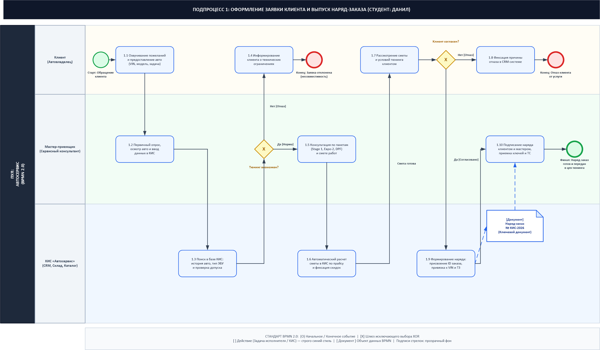
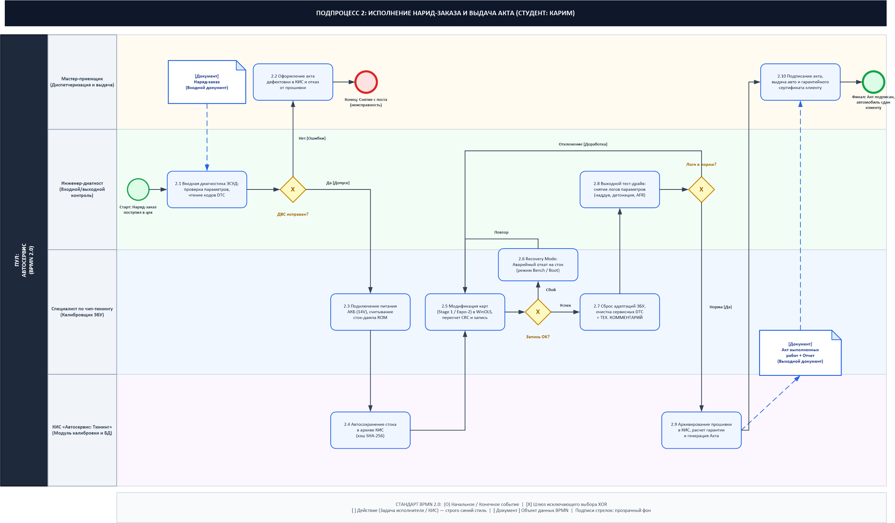
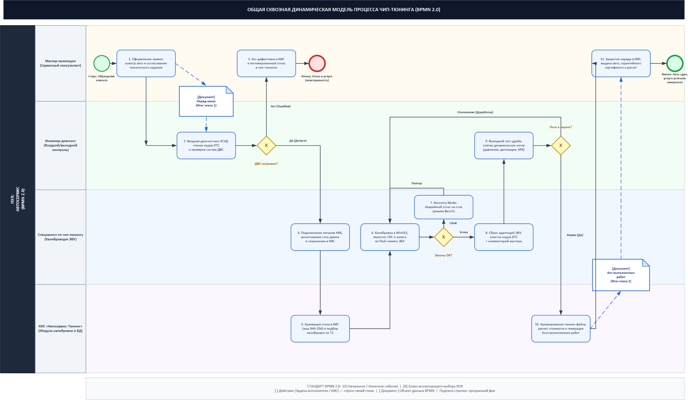

# Отчет по лабораторной работе (Часть 2) по дисциплине «Корпоративные информационные системы»

**Тема:** «Динамическое моделирование подпроцессов автосервиса в нотации BPMN 2.0: Оформление заявки клиента (Данил), Исполнение наряд-заказа (Карим) и Сквозная модель чип-тюнинга»  
**Выполнили:** студенты гр. ЭАС-514С Гайнанов Д.И. (Данил), [Партнер] (Карим)  
**Проверил:** ст. преподаватель кафедры АСУ Демченко М.С.  
**Университет:** ФГБОУ ВО «Уфимский университет науки и технологий» (УУНиТ), Кафедра автоматизированных систем управления  
**Год:** 2026  

---

## Введение

В рамках дисциплины «Корпоративные информационные системы» (КИС) разработка моделей системного уровня требует перехода от статических описаний структуры предприятия к **динамическому моделированию бизнес-процессов**. 

Динамическая модель процесса отражает поведение системы во времени:
1. Хронологическую последовательность технологических и управленческих операций;
2. Событийную логику (стартовые, промежуточные, граничные события и обработку аварийных сбоев);
3. Логические развилки (шлюзы исключающего выбора XOR);
4. Распределение ответственности участников по дорожкам ролей (Swimlanes);
5. Взаимодействие сотрудников с модулями КИС и внешним оборудованием;
6. Циркуляцию первичных и отчетных документов (Data Objects).

В соответствии с требованиями преподавателя кафедры АСУ Демченко М.С., пункт 2 лабораторной работы разделен между студентами проектной группы со следующей четкой специализацией:
- **Студент 1 (Данил):** разработка динамической модели подпроцесса **«Оформление заявки клиента и согласование»**. На входе — первичное обращение клиента и автомобиль, на выходе — утвержденный ключевой документ **«Наряд-заказ»**.
- **Студент 2 (Карим):** разработка динамической модели подпроцесса **«Исполнение наряд-заказа в производственной зоне»**. На входе — получение документа **«Наряд-заказ»**, технологический цикл включает входную диагностику, перепрограммирование ЭБУ с обязательным добавлением **технического комментария**, выходной контроль и завершается выпуском выходного документа — **«Акт выполненных работ»**.
- **Сквозная динамическая интеграционная модель:** объединение обоих подпроцессов в непрерывный сквозной цикл автосервиса.

Все схемы реализованы в Microsoft Visio с соблюдением требований стандарта BPMN 2.0:
- Форма для действий (Tasks) — строгий синий стиль (soft blue fill, royal blue border);
- Форма для документов (Data Objects) — специальный блок со скошенным уголком;
- Подписи стрелок (Sequence Flow) — прозрачный фон без перекрывающих фоновых плашек.

---

## 1. Подпроцесс 1: «Оформление заявки клиента и выпуск наряд-заказа» (Студент: Данил)

### 1.1 Характеристика и ролевая модель
Подпроцесс регламентирует первичное взаимодействие автовладельца с сервисом.
- **Вход:** Обращение клиента, автомобиль, СТС, пожелания к чип-тюнингу (Stage 1 / Евро-2 / отключение экологии).
- **Выход:** Утвержденный и подписанный документ **«Наряд-заказ № КИС-2026»**, автомобиль принят в цех.
- **Дорожки (Swimlanes):**
  1. *Клиент (Автовладелец)* — формулирует задачу, рассматривает смету, принимает решение о согласовании.
  2. *Мастер-приемщик (Сервисный консультант)* — проводит осмотр авто, фиксирует VIN и пробег, консультирует по пакетам доработок, подписывает наряд.
  3. *КИС «Автосервис» (CRM, Склад, Каталог)* — автоматический поиск по базе данных типа ЭБУ, проверка совместимости, калькуляция сметы по прайс-листу, генерация номера и бланка наряд-заказа.

### 1.2 Графическая диаграмма BPMN 2.0 (Данил)
- **Файл Visio:** [Подпроцесс_1_Оформление_заявки_Данил_BPMN.vsdx](file:///c:/Users/danch/OneDrive/Рабочий%20стол/stage5/КИС/Подпроцесс_1_Оформление_заявки_Данил_BPMN.vsdx)
- **Файл изображения:** [Подпроцесс_1_Оформление_заявки_Данил_BPMN.png](file:///c:/Users/danch/OneDrive/Рабочий%20стол/stage5/КИС/Подпроцесс_1_Оформление_заявки_Данил_BPMN.png)

### 1.3 Логика шагов и развилок:
1. **Шаг 1.1:** Клиент обращается в сервис (Старт) и озвучивает пожелания (Stage 1, Euro-2).
2. **Шаг 1.2:** Мастер-приемщик опрашивает клиента, осматривает ТС и заносит VIN и пробег в КИС.
3. **Шаг 1.3:** КИС автоматически проверяет историю авто, тип ЭБУ и допуск к чип-тюнингу.
4. **Шлюз XOR «Тюнинг возможен?»:**
   - *Нет [Отказ]:* Мастер информирует клиента о технических ограничениях (шаг 1.4) $\rightarrow$ Конечное событие-ошибка (Заявка отклонена).
   - *Да [Норма]:* Мастер консультирует по пакетам доработок и смете (шаг 1.5).
5. **Шаг 1.6:** КИС автоматически рассчитывает смету работ по прайс-листу с фиксацией скидок.
6. **Шаг 1.7:** Клиент рассматривает смету и условия гарантии.
7. **Шлюз XOR «Клиент согласен?»:**
   - *Нет [Отказ]:* Фиксация причины отказа в CRM (шаг 1.8) $\rightarrow$ Конечное событие (Отказ клиента).
   - *Да [Согласовано]:* Переход к генерации заказа в КИС.
8. **Шаг 1.9:** КИС формирует заказ: присвоение ID, привязка к VIN и ТЗ $\rightarrow$ генерируется **Документ «Наряд-заказ № КИС-2026»**.
9. **Шаг 1.10:** Клиент и мастер подписывают наряд-заказ, передаются ключи и авто $\rightarrow$ **Финал:** наряд-заказ передан в цех тюнинга.

---

## 2. Подпроцесс 2: «Исполнение наряд-заказа и выдача акта» (Студент: Карим)

### 2.1 Характеристика и ролевая модель
Подпроцесс охватывает полный цикл производственных и диагностических операций в цеху тюнинга.
- **Вход:** Получение документа **«Наряд-заказ»** из зоны приемки, автомобиль на посту.
- **Выход:** Перепрограммированный автомобиль, электронный **«Акт выполненных работ + Отчет о калибровке»**, гарантийный сертификат.
- **Дорожки (Swimlanes):**
  1. *Мастер-приемщик* — диспетчеризация, контроль сроков, итоговая сдача авто клиенту.
  2. *Инженер-диагност* — входной контроль ЭСУД, проверка параметров наддува/форсунок, допуск к работам, выходной тест-драйв с логированием.
  3. *Специалист по чип-тюнингу (Калибровщик)* — подключение стабилизатора АКБ 14V, вычитка стока, калибровка в WinOLS, запись ПО, аварийное восстановление (Recovery Mode), сброс адаптаций и внесение обязательного **технического комментария**.
  4. *КИС «Автосервис: Тюнинг»* — автоматическое SHA-256 хэширование, WORM-архивирование стоковых дампов, расчет гарантии, автогенерация Акта выполненных работ.

### 2.2 Графическая диаграмма BPMN 2.0 (Карим)
- **Файл Visio:** [Подпроцесс_2_Исполнение_заказа_Карим_BPMN.vsdx](file:///c:/Users/danch/OneDrive/Рабочий%20стол/stage5/КИС/Подпроцесс_2_Исполнение_заказа_Карим_BPMN.vsdx)
- **Файл изображения:** [Подпроцесс_2_Исполнение_заказа_Карим_BPMN.png](file:///c:/Users/danch/OneDrive/Рабочий%20стол/stage5/КИС/Подпроцесс_2_Исполнение_заказа_Карим_BPMN.png)

### 2.3 Логика шагов (Получение наряда $\rightarrow$ Выполнение + коммент $\rightarrow$ Акт):
1. **Старт и получение наряда:** Цех принимает входной документ **«Наряд-заказ»** $\rightarrow$ передача на диагностику.
2. **Шаг 2.1:** Диагност выполняет входное сканирование кодов ошибок DTC и параметров ДВС.
3. **Шлюз XOR «ДВС исправен?»:**
   - *Нет [Ошибки]:* Оформление акта дефектовки в КИС (шаг 2.2) $\rightarrow$ Снятие с поста.
   - *Да [Допуск]:* Передача ТС калибровщику.
4. **Шаг 2.3:** Подключение стабилизатора АКБ (14V) и вычитывание сток-дампа ROM через программатор.
5. **Шаг 2.4:** КИС автоматически сохраняет сток в архив с расчетом хэша SHA-256.
6. **Шаг 2.5:** Модификация карт (Stage 1 / Евро-2) в WinOLS, пересчет контрольной суммы CRC32 и запись во Flash ЭБУ.
7. **Шлюз XOR «Запись OK?»:**
   - *Сбой [Ошибка]:* Активация шага 2.6 **«Recovery Mode»** (аварийный откат на сток в Bench/Boot режиме) с возвратом на повторную запись.
   - *Успех:* Переход к финализации прошивки.
8. **Шаг 2.7 (Выполнение + коммент):** Сброс сервисных адаптаций ЭБУ, очистка кодов DTC и **внесение подробного технического комментария мастера** в КИС (параметры прироста мощности, марка бензина АИ-100, регламент обслуживания).
9. **Шаг 2.8:** Диагност проводит выходной тест-драйв со снятием динамических логов под нагрузкой.
10. **Шлюз XOR «Логи в норме?»:**
    - *Отклонение [Доработка]:* Возврат калибровщику на корректировку карт наддува/зажигания.
    - *Норма [Да]:* Передача параметров в КИС.
11. **Шаг 2.9:** КИС архивирует финальный файл прошивки, рассчитывает гарантию и генерирует выходной **Документ «Акт выполненных работ + Отчет»**.
12. **Шаг 2.10:** Мастер-приемщик подписывает Акт с клиентом, выдает авто и гарантийный сертификат $\rightarrow$ **Финал:** Услуга успешно завершена.

---

## 3. Общая сквозная интеграционная динамическая модель процесса

### 3.1 Взаимосвязь этапов и потоков данных
Сквозная модель объединяет фронт-офисную часть оформления заявки (Данил) и цеховую часть исполнения наряд-заказа (Карим) в непрерывный процесс. Информационным мостом между этапами выступают стандартизированные документы:
- **«Наряд-заказ»** — результат этапа согласования (Данил) и директива на выполнение работ в цеху (Карим);
- **«Акт выполненных работ»** — отчетный результат производственного этапа (Карим), основание для взаиморасчетов и выдачи авто.

### 3.2 Графическая диаграмма BPMN 2.0 (Общая модель)
- **Файл Visio:** [Общая_динамическая_модель_чип_тюнинг_BPMN.vsdx](file:///c:/Users/danch/OneDrive/Рабочий%20стол/stage5/КИС/Общая_динамическая_модель_чип_тюнинг_BPMN.vsdx)
- **Файл изображения:** [Общая_динамическая_модель_чип_тюнинг_BPMN.png](file:///c:/Users/danch/OneDrive/Рабочий%20стол/stage5/КИС/Общая_динамическая_модель_чип_тюнинг_BPMN.png)

### 3.3 Сводная матрица ответственности (RACI)
*Обозначения: R — Исполнитель (Responsible), A — Ответственный (Accountable), C — Консультант (Consulted), I — Информируемый (Informed).*

| Шаг сквозного процесса | Мастер | Диагност | Тюнер | КИС | Ответственный исполнитель |
| :--- | :---: | :---: | :---: | :---: | :---: |
| **1.1** Озвучивание пожеланий и осмотр авто | **R / A** | I | I | Регистрация | Данил (Этап 1) |
| **1.2** Поиск в базе КИС истории и типа ЭБУ | I | C | I | **R / A** | Данил (Этап 1) |
| **1.3** Консультация по пакетам и расчет сметы | **R / A** | I | I | Калькуляция | Данил (Этап 1) |
| **1.4** Согласование и выпуск Наряд-заказа | **R / A** | I | I | Документ | Данил (Этап 1) |
| **2.1** Получение наряд-заказа и входная диагн. | I | **R / A** | C | Поддержка | Карим (Этап 2) |
| **2.2** Подключение АКБ 14V и вычитка стока | I | I | **R / A** | I | Карим (Этап 2) |
| **2.3** Автоархивация сток-дампа (SHA-256) | I | I | I | **R / A** | Карим (Этап 2) |
| **2.4** Модификация карт в WinOLS и запись | I | C | **R / A** | I | Карим (Этап 2) |
| **2.5** Аварийное восстановление (Recovery) | I | C | **R / A** | Логирование | Карим (Этап 2) |
| **2.6** Сброс адаптаций + ТЕХ. КОММЕНТАРИЙ | I | I | **R / A** | Фиксация | Карим (Этап 2) |
| **2.7** Выходной тест-драйв со снятием логов | I | **R / A** | C | I | Карим (Этап 2) |
| **2.8** Формирование Акта выполненных работ | I | I | I | **R / A** | Карим (Этап 2) |
| **2.9** Выдача авто, сертификата и закрытие | **R / A** | I | I | Архивация | Карим (Этап 2) |

---

## 4. Детальные бизнес-сценарии (ДБС) ключевых операций

### Шаг 1.1: Оформление заявки клиента и осмотр автомобиля (Данил)
- **Исполнитель:** Мастер-приемщик.
- **Вход:** СТС, ключи от ТС, устное техническое задание клиента.
- **Выход:** Электронная карточка обращения в КИС, статус «На согласовании».
- **Действия:** Мастер фиксирует пробег, VIN, тип желаемой модификации (Stage 1 / Евро-2 / EGR OFF) и заносит в АРМ приемки КИС.
- **Атрибуты в КИС:** `VIN-код`, `Марка и модель`, `Текущий пробег`, `Пакет работ`.
- **Требования к КИС:** Быстрое распознавание СТС камерой планшета и автозаполнение комплектации авто.

### Шаг 1.9: Формирование документа «Наряд-заказ» в КИС (Данил)
- **Исполнитель:** КИС «Автосервис» / Мастер-приемщик.
- **Условия:** Смета утверждена клиентом, техническая возможность подтверждена.
- **Выход:** Документ «Наряд-заказ № КИС-2026» (статус «Передан в цех»), подписанный бланк.
- **Действия:** Система присваивает уникальный номер заказа, привязывает перечень работ, генерирует штрихкод и выводит на печать бланк наряд-заказа.
- **Атрибуты в КИС:** `Номер наряд-заказа`, `Плановое время готовности`, `Сметная стоимость`, `Статус наряда`.

### Шаг 2.1: Входная диагностика ЭСУД по наряд-заказу (Карим)
- **Исполнитель:** Инженер-диагност.
- **Вход:** Документ «Наряд-заказ», диагностический сканер J2534 PassThru.
- **Выход:** Диагностический протокол DTC Log, статус допуска в КИС.
- **Действия:** Сканирование штрихкода наряда, считывание кодов ошибок, проверка баланса форсунок, давления наддува и топливных коррекций LTFT.

### Шаг 2.7: Сброс адаптаций и внесение ТЕХНИЧЕСКОГО КОММЕНТАРИЯ (Карим)
- **Исполнитель:** Специалист по чип-тюнингу.
- **Условия:** Запись прошивки завершена успешно, контрольная сумма CRC32 верифицирована.
- **Выход:** Сброшенные адаптации ДВС, сохраненный технический комментарий в КИС.
- **Действия:** Калибровщик производит сброс адаптаций по топливу и заслонке, после чего вносит в КИС комментарий: расчетный прирост (+35 л.с., +65 Нм), тип требуемого бензина (АИ-100) и рекомендации по интервалам ТО.

### Шаг 2.9: Генерация документа «Акт выполненных работ» (Карим)
- **Исполнитель:** КИС «Автосервис: Тюнинг» / Мастер-приемщик.
- **Условия:** Логи выходного тест-драйва подтвердили стабильность параметров.
- **Выход:** Документ «Акт выполненных работ + Отчет о калибровке», статус наряда «Выполнен».
- **Действия:** КИС сохраняет тюнинг-файл, формирует электронный Акт с графиками и гарантийным сертификатом. Мастер подписывает акт с клиентом и закрывает заказ.

---

## 5. Архитектура интеграции и защита данных в КИС

1. **Интеграция с J2534 PassThru:** Стандартизированный интерфейс для взаимодействия КИС с диагностическими сканерами и программаторами (чтение DTC, логов и идентификаторов ЭБУ без ручного ввода).
2. **Интеграция с WinOLS API:** Автоматизированный обмен проектами калибровок, импорт масок отключения экологических систем и карт зажигания/наддува.
3. **Криптографическая защита и архивация:** Хэширование считанных файлов по алгоритму SHA-256 с неизменяемым хранением (WORM) оригинальных сток-прошивок клиентов для обеспечения возможности бесплатного отката.
4. **Сквозная преемственность документооборота:** Ни один этап в цеху не может быть начат без подписанного «Наряд-заказа» (Данил), а финансовый расчет и выдача авто не могут состояться без сформированного «Акта выполненных работ» с техническим комментарием мастера (Карим).

---

## Заключение

В ходе выполнения лабораторной работы студентами Гайнановым Д.И. (Данил) и [Партнером] (Карим) были успешно решены все поставленные задачи:
1. Построена динамическая модель подпроцесса 1 «Оформление заявки клиента» (Данил) с выпуском ключевого документа **«Наряд-заказ»**;
2. Построена динамическая модель подпроцесса 2 «Исполнение наряд-заказа» (Карим) по регламенту **«Получение наряд-заказа $\rightarrow$ Выполнение + технический комментарий $\rightarrow$ Выдача Акта выполненных работ»**;
3. Построена общая сквозная динамическая интеграционная модель автосервиса в стандарте BPMN 2.0;
4. Все графические схемы реализованы в Microsoft Visio (.vsdx) с соблюдением требований к стилям (синий цвет для действий, значок документа для Data Objects, прозрачный фон подписей стрелок);
5. Разработана сводная матрица ответственности RACI и детальные спецификации бизнес-сценариев (ДБС) экранных форм КИС;
6. Сформирован итоговый отчет в формате Word ([Отчет_Динамическая_модель_подпроцесса.docx](file:///c:/Users/danch/OneDrive/Рабочий%20стол/stage5/КИС/Отчет_Динамическая_модель_подпроцесса.docx)).

---

## Список используемых источников

1. ГОСТ Р ИСО/МЭК 19510-2015. Информационные технологии. Нотация и модель бизнес-процессов (BPMN 2.0). — М.: Стандартинформ, 2016. — 250 с.
2. Корпоративные информационные системы: курс лекций / сост. М.С. Демченко. — Уфа: УУНиТ (УГАТУ), каф. АСУ, 2024–2026.
3. Репин В.В., Елиферов В.Г. Процессный подход к управлению. Моделирование бизнес-процессов. — М.: РИА «Стандарты и качество», 2019. — 408 с.
4. Громов А.И. Управление бизнес-процессами: современные методы: монография / А.И. Громов, А. Фляйшман, В. Шмидт. — М.: Издательство Юрайт, 2021. — 367 с.
5. Bosch. Automotive Electrics and Automotive Electronics: Systems and Components, Networking and Hybrid Drive (Bosch Professional Automotive Information). — Springer Vieweg, 2018. — 530 p.
6. SAE J2534-1: Recommended Practice for Pass-Thru Programming. — SAE International, 2020.
